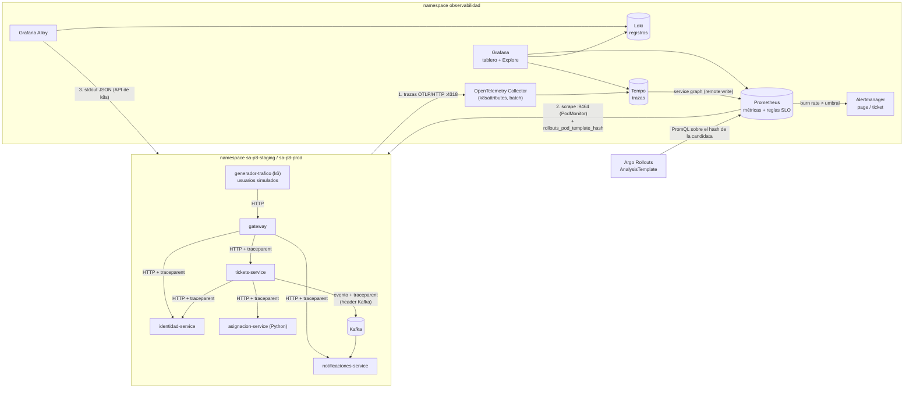

# Flujo de telemetría — del servicio al tablero y a la alerta

Recorrido de las tres señales (métricas, trazas y registros) desde cada
microservicio hasta Grafana y Alertmanager, y de la métrica de vuelta al
canary. Todo lo que está dentro de `observabilidad` lo despliega ArgoCD
desde `sa-platform-gitops/observabilidad/`.

## Las tres señales y su correlación

| Señal | Productor | Transporte | Almacén | Clave de correlación |
|---|---|---|---|---|
| **Trazas** | SDK de OpenTelemetry (auto-instrumentación de http, express, undici/fetch, pg, kafkajs, FastAPI, SQLAlchemy) | OTLP/HTTP → Collector → OTLP/gRPC | Tempo | `trace_id` (propagado con `traceparent` en HTTP y en headers de Kafka) |
| **Métricas** | SDK de OpenTelemetry (exporter Prometheus en `:9464`): `sa_http_server_duration_seconds` y las de negocio | *pull*: Prometheus scrapea con un PodMonitor | Prometheus | etiquetas `service`, `namespace`, `rollouts_pod_template_hash` |
| **Registros** | `logger.ts` / `observability.py`: una línea JSON por evento | stdout → Alloy (API de Kubernetes) | Loki (`trace_id` como *structured metadata*, `level` como etiqueta) | `trace_id`, `span_id` |

**Saltos en Grafana:**
- **Registro → traza:** *derived field* sobre `"trace_id"` en Loki, botón *Ver traza en Tempo*.
- **Traza → registros:** `tracesToLogsV2` en Tempo; el span ofrece *Logs for this span* con la consulta `| json | trace_id="<id>"`.
- **Métrica → registros:** el panel *Registros con nivel error* del tablero filtra por el mismo ambiente y servicio.

## Por qué métricas *pull* y trazas *push*

- Las **métricas** se scrapean directo de cada pod, sin pasar por el
  Collector. Así Prometheus agrega las etiquetas del pod, en particular
  `rollouts-pod-template-hash`. Sin esa etiqueta el AnalysisTemplate no
  podría separar el tráfico de la versión candidata del de la estable.
- Las **trazas** pasan por el Collector para que los servicios no
  conozcan el backend. Cambiar Tempo por Jaeger, o agregar muestreo, se
  hace en un solo lugar.

## Camino a la alerta

`sa_http_server_duration_seconds_count{service="gateway"}` →
reglas de registro `slo:sli_error:ratio_rate{5m,30m,1h,6h,30d}` →
`slo:burnrate:*` → alerta `SLO*ConsumoRapidoPresupuesto` (14.4x en 1 h y
5 min) → Alertmanager (receptor `guardia-pager`) → runbook en
`P10/docs/runbooks/`.
