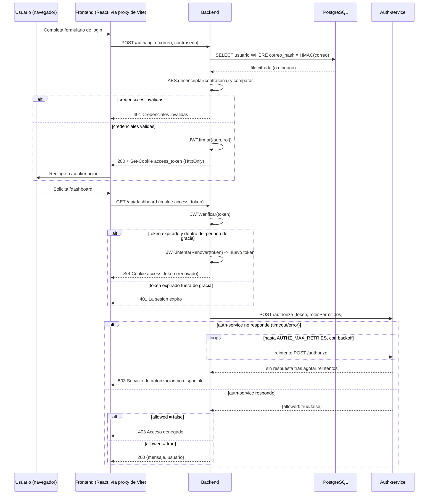

# Practica 2 — Autenticacion y Autorizacion

Practica del curso Software Avanzado (USAC), seccion B, carne 201800678.

Modulo de registro, login y autorizacion por roles (Admin/Cliente) sobre una aplicacion
full-stack, con JWT almacenado en cookie HTTP-only, renovacion automatica del token, y
datos sensibles cifrados con AES. La autorizacion por roles se resuelve mediante un
microservicio independiente, consultado por el backend con un ciclo de reintentos y backoff.

**Estado actual:** funcional. Registro, login, renovacion automatica del JWT, cifrado AES de
datos sensibles y autorizacion por roles via el microservicio independiente estan implementados
y verificados de extremo a extremo (`docker compose up`, con los 4 servicios reales).

## Stack

- Backend y microservicio de autorizacion: Node.js + TypeScript + Express
- Frontend: React + TypeScript (Vite)
- Base de datos: PostgreSQL (Docker)
- Autenticacion: JWT (`jsonwebtoken`) en cookie HTTP-only (`cookie-parser`)
- Cifrado de datos sensibles: AES-256-GCM (`node:crypto`, sin dependencias adicionales)
- Validacion de entrada: `zod`
- Gestor de paquetes: `pnpm` en los tres servicios Node
- Orquestacion: Docker Compose (los 4 servicios: `postgres`, `auth-service`, `backend`, `frontend`)

## Estructura de carpetas

```
P2/
├── backend/               # API REST: registro, login, rutas protegidas de ejemplo
│   ├── src/
│   │   ├── domain/        # Entidad Usuario, puertos (repositorio, JWT, AES, cliente de autorizacion), errores
│   │   ├── application/   # Casos de uso (registro, login) y DTOs
│   │   ├── infrastructure/ # Postgres, JWT, AES y cliente HTTP del microservicio de autorizacion
│   │   ├── interfaces/http/ # Controladores, rutas, middlewares (auth, autorizacion, errores), validadores
│   │   ├── config/
│   │   ├── app.ts         # Composition root
│   │   └── server.ts
│   └── Dockerfile
├── auth-service/           # Microservicio independiente: verifica JWT y responde permitido/denegado por rol
│   ├── src/
│   │   ├── domain/
│   │   ├── infrastructure/security/
│   │   ├── interfaces/http/
│   │   ├── config/
│   │   ├── app.ts
│   │   └── server.ts
│   └── Dockerfile
├── frontend/                # Registro, login, pagina de confirmacion, rutas protegidas de ejemplo
│   ├── src/
│   │   ├── pages/
│   │   ├── api/
│   │   ├── App.tsx
│   │   └── main.tsx
│   └── Dockerfile
├── docker-compose.yml       # postgres + auth-service + backend + frontend
├── .env.example
├── README.md
└── PROMPTS.md
```

La regla de dependencia dentro de `backend/` y `auth-service/` es la misma usada en P1:
`interfaces` → `application` → `domain`, e `infrastructure` implementa contratos definidos en
`domain`. El microservicio de autorizacion es un servicio HTTP separado (no un modulo
importado): el backend lo consulta por red, nunca importa su codigo directamente.

## Diseno de la entidad `Usuario` (no especificada literalmente en el enunciado)

| Campo | Tipo | Nota |
|---|---|---|
| `id` | UUID | |
| `nombre` | cifrado AES-256-GCM | dato sensible |
| `correo` | cifrado AES-256-GCM + `correo_hash` (HMAC-SHA256) | el hash permite `WHERE correo_hash = ?` en el login sin desencriptar toda la tabla |
| `contrasena` | cifrado AES-256-GCM (reversible) | se descifra para comparar en el login, segun lo definido para esta practica |
| `rol` | `admin` \| `cliente` (texto plano) | no es dato personal; se usa para autorizacion |

## Variables de entorno

Ver `.env.example` en la raiz de `P2/` (consumido por `docker-compose.yml`). Incluye
`JWT_SECRET`, `JWT_EXPIRES_IN`, `JWT_REFRESH_GRACE_PERIOD`, `AES_SECRET_KEY`,
`AUTHZ_SERVICE_URL`, `AUTHZ_MAX_RETRIES`, `AUTHZ_RETRY_BACKOFF_MS`, las credenciales de la cuenta
Admin creada automaticamente al arrancar (`ADMIN_NOMBRE`, `ADMIN_EMAIL`, `ADMIN_PASSWORD`),
ademas de las credenciales de PostgreSQL y los puertos de cada servicio.

## Como levantar el proyecto

```
cp .env.example .env
docker compose up -d
```

Esto levanta los 4 servicios juntos. Frontend en `http://localhost:5173`, backend en
`http://localhost:4000`, auth-service en `http://localhost:4100`, PostgreSQL en el puerto
`5433` del host.

## Endpoints

| Servicio | Metodo | Ruta | Descripcion | Exito | Errores |
|---|---|---|---|---|---|
| backend | POST | `/auth/registro` | Crear una cuenta (siempre con rol `cliente`) | 201 | 400, 409 |
| backend | POST | `/auth/login` | Iniciar sesion (setea cookie HTTP-only `access_token`) | 200 | 400, 401 |
| backend | POST | `/auth/logout` | Cerrar sesion (limpia la cookie) | 204 | — |
| backend | GET | `/api/admin/panel` | Ruta 1 — solo Admin | 200 | 401, 403, 503 |
| backend | GET | `/api/dashboard` | Ruta 2 — Admin y Cliente | 200 | 401, 403, 503 |
| auth-service | POST | `/authorize` | Recibe `{ token, rolesPermitidos }`, responde `{ allowed: boolean }` | 200 | 400 |

`503` en las rutas protegidas significa que el microservicio de autorizacion no respondio tras
agotar los reintentos configurados (`AUTHZ_MAX_RETRIES`).

### Cuenta Admin

El registro publico (`POST /auth/registro`) siempre crea usuarios con rol `cliente`: el rol no es
auto-asignable via API, para evitar que cualquiera se otorgue permisos de administrador. Para
poder probar la Ruta 1 sin pasos manuales, el backend crea automaticamente una cuenta Admin al
arrancar por primera vez (si no existe todavia), con las credenciales definidas en `.env`
(`ADMIN_NOMBRE`, `ADMIN_EMAIL`, `ADMIN_PASSWORD`; por defecto `admin@admin.com` /
`Admin12345`). Esto lo hace `seedAdminUsuario`
(`backend/src/infrastructure/bootstrap/seedAdminUsuario.ts`), llamado desde el composition root
(`app.ts`) antes de levantar el servidor; es idempotente, no crea duplicados en reinicios
posteriores.

Cualquier otro usuario existente tambien puede promoverse a Admin directamente en la base de
datos, usando el `id` devuelto por el registro o el login:

```
docker compose exec postgres psql -U p2_user -d p2_auth_db -c "UPDATE usuarios SET rol = 'admin' WHERE id = '<uuid>';"
```

## Tecnologias usadas: que son, por que se eligieron, ventajas y desventajas

### JWT (JSON Web Token)

Un JWT es un estandar para representar informacion firmada digitalmente de forma compacta: el
servidor la emite y puede verificar despues que no fue alterada, sin tener que consultar una base
de datos de sesiones en cada peticion (es *stateless*). Se uso porque el enunciado lo exige
explicitamente como mecanismo de autenticacion, firmado con `JWT_SECRET` y con tiempo de vida
configurable via `JWT_EXPIRES_IN`.

- **Ventajas:** no requiere guardar sesiones en el servidor (facilita escalar horizontalmente);
  es autocontenido (el `rol` viaja dentro del propio token, evitando una consulta a la base de
  datos en cada verificacion); tiene soporte maduro en practicamente cualquier lenguaje.
- **Desventajas:** un JWT no se puede invalidar individualmente antes de que expire sin
  infraestructura adicional (ej. una lista de revocacion); si `JWT_SECRET` se filtra, cualquiera
  puede firmar tokens validos; y es mas pesado que un simple id de sesion opaco.

### AES-256-GCM (cifrado de datos sensibles)

AES es un algoritmo de cifrado simetrico (la misma clave cifra y descifra). Se uso el modo GCM
porque, ademas de confidencialidad, agrega un `authTag` que permite detectar si el texto cifrado
fue modificado. Se eligio cifrado **reversible** (en vez de un hash de un solo sentido) porque la
rubrica de esta practica pide explicitamente que nombre, correo y contrasena se desencripten en
el flujo de autenticacion.

- **Ventajas:** reversible (permite recuperar nombre/correo en texto plano para mostrarlos en la
  UI, algo que un hash no permite); rapido; GCM protege tambien la integridad del dato, no solo
  su confidencialidad.
- **Desventajas:** al ser reversible, si `AES_SECRET_KEY` se filtra, **todos** los datos cifrados
  quedan expuestos de inmediato — a diferencia de un hash como bcrypt/argon2, que sigue siendo
  costoso de revertir incluso si se filtra. Por esa razon, cifrar la contrasena con AES (en vez de
  hashearla) **no es la practica recomendada por la industria para contrasenas**; aqui se hizo asi
  deliberadamente para cumplir el requisito literal de la rubrica de esta practica academica, no
  porque sea la opcion mas segura en un sistema real.

### Cookies HTTP-only

El atributo `HttpOnly` de una cookie impide que JavaScript en el navegador (`document.cookie`) lea
su valor; solo el navegador la envia automaticamente en las peticiones al servidor. Se uso porque
el enunciado prohibe que el token quede en un lugar visible/accesible para el usuario (ej.
`localStorage`).

- **Ventajas:** mitiga el robo del token via XSS, ya que un script inyectado no puede leerla; el
  navegador la adjunta automaticamente, sin logica adicional en el frontend.
- **Desventajas:** es vulnerable a CSRF si no se toman medidas adicionales (aqui se mitiga con
  `SameSite=lax`); y para que el navegador la envie sin fricciones entre frontend y backend en
  distintos puertos hace falta evitar el escenario cross-site — por eso el frontend usa un proxy
  de Vite hacia el backend (`vite.config.ts`) en vez de llamarlo directamente, manteniendo todo en
  el mismo origen desde la perspectiva del navegador.

## Diagrama de secuencia

Flujo de login (con contraseña incorrecta y correcta) y de acceso a una ruta protegida,
incluyendo la renovacion automatica del JWT y la consulta con reintentos al microservicio de
autorizacion:



## Principios SOLID

Esta seccion documenta como se aplica cada uno de los cinco principios en la implementacion
actual, con el fragmento de codigo correspondiente como evidencia.

### SRP — Principio de Responsabilidad Unica

Una clase debe tener una sola razon para cambiar. `backend/src/application/use-cases/LoginUsuarioUseCase.ts`
solo orquesta la validacion de credenciales y la emision del token; no sabe nada de HTTP, SQL ni
JWT concretos:

```ts
export class LoginUsuarioUseCase {
  constructor(
    private readonly usuarioRepository: IUsuarioRepository,
    private readonly tokenService: ITokenService
  ) {}

  async execute(dto: LoginDTO): Promise<LoginResultado> {
    const usuario = await this.usuarioRepository.findByCorreo(dto.correo);
    if (!usuario || usuario.contrasena !== dto.contrasena) {
      throw new CredencialesInvalidasError();
    }
    const token = this.tokenService.firmar({ sub: usuario.id, rol: usuario.rol });
    return { usuario: { id: usuario.id, nombre: usuario.nombre, correo: usuario.correo, rol: usuario.rol }, token };
  }
}
```

De forma simetrica, `AuthController` (`backend/src/interfaces/http/controllers/`) solo traduce
HTTP ↔ casos de uso (valida el body, llama al caso de uso, setea la cookie); no valida
credenciales ni firma tokens. Cada clase cambia por una razon distinta.

### OCP — Principio de Abierto/Cerrado

El codigo debe poder extenderse sin modificar lo ya probado. `errorHandler.ts` (presente tanto en
`backend/` como en `auth-service/`) decide la respuesta HTTP segun el *tipo* de error, apoyandose
en la clase abstracta `DomainError`:

```ts
if (err instanceof DomainError) {
  res.status(err.statusCode).json({ error: err.message });
  return;
}
```

Los siete errores de dominio del backend (`CorreoYaRegistradoError`, `CredencialesInvalidasError`,
`TokenAusenteError`, `TokenInvalidoError`, `TokenExpiradoError`, `AccesoDenegadoError`,
`ServicioAutorizacionNoDisponibleError`) se agregaron sin tocar una sola linea de
`errorHandler.ts`: el manejador esta *cerrado* a modificacion pero *abierto* a los errores nuevos
que se le sumen.

### LSP — Principio de Sustitucion de Liskov

Cualquier implementacion de una abstraccion debe poder sustituirla sin romper el comportamiento
esperado. `PostgresUsuarioRepository` (`backend/src/infrastructure/repositories/`) implementa
`IUsuarioRepository` respetando exactamente su contrato (mismos parametros, mismos tipos de
retorno):

```ts
export class PostgresUsuarioRepository implements IUsuarioRepository {
  async findByCorreo(correo: string): Promise<Usuario | null> {
    const correoHash = this.cifradoService.hash(this.normalizarCorreo(correo));
    const result = await this.pool.query<UsuarioRow>(
      `SELECT ${SELECT_COLUMNS} FROM usuarios WHERE correo_hash = $1`,
      [correoHash]
    );
    return result.rows[0] ? this.toEntity(result.rows[0]) : null;
  }
  // ...
}
```

`RegistrarUsuarioUseCase` y `LoginUsuarioUseCase` funcionan igual sin importar que clase concreta
reciban, siempre que respete el contrato — por ejemplo, en pruebas podria sustituirse por un
repositorio en memoria sin cambiar una sola linea de la capa de aplicacion.

### ISP — Principio de Segregacion de Interfaces

Una interfaz no debe forzar a quien la implementa a depender de metodos que no usa. En vez de una
sola interfaz grande de "seguridad", el dominio define tres puertos pequenos y especificos —
`ITokenService` (`backend/src/domain/services/ITokenService.ts`), `ICifradoService` y
`IAuthorizationServiceClient` — cada uno con solo los metodos que su consumidor necesita:

```ts
export interface ICifradoService {
  encriptar(texto: string): string;
  desencriptar(textoEncriptado: string): string;
  hash(texto: string): string;
}
```

`IUsuarioRepository` sigue el mismo criterio: expone unicamente `findByCorreo` y `create`, los
dos unicos metodos que los casos de uso de esta practica necesitan — ni un CRUD generico de mas.

### DIP — Principio de Inversion de Dependencias

Los modulos de alto nivel no deben depender de modulos de bajo nivel; ambos deben depender de una
abstraccion. Los casos de uso dependen unicamente de interfaces definidas en `domain/`, nunca de
`PostgresUsuarioRepository`, `JwtTokenService` o `AuthorizationServiceClient` directamente:

```ts
// backend/src/interfaces/http/middlewares/authorize.ts
export function buildAuthorize(authorizationServiceClient: IAuthorizationServiceClient) {
  return function authorize(rolesPermitidos: RolUsuario[]) {
    return async function (req: AuthenticatedRequest, res: Response, next: NextFunction) {
      const permitido = await authorizationServiceClient.autorizar(req.token!, rolesPermitidos);
      // ...
    };
  };
}
```

La unica pieza del proyecto que conoce las implementaciones concretas es el *composition root*,
`backend/src/app.ts`, donde se conectan las abstracciones con `PostgresUsuarioRepository`,
`JwtTokenService`, `AesCifradoService` y `AuthorizationServiceClient` reales. Si mañana cambiara
el motor de base de datos o la libreria de JWT, solo se reemplazarian esas lineas en `app.ts`.

## Notas de verificacion

Probado de extremo a extremo con los 4 servicios reales via `docker compose up`: registro,
registro duplicado (409), login correcto/incorrecto, acceso Cliente/Admin a ambas rutas
protegidas (incluyendo el 403 cuando corresponde), creacion automatica de la cuenta Admin al
arrancar (y su idempotencia en reinicios posteriores), datos verificados como cifrados en
PostgreSQL, renovacion automatica del JWT dentro del periodo de gracia, expiracion fuera de ese
periodo, y el ciclo de reintentos con backoff del backend cuando `auth-service` estaba caido
(respondiendo 503 tras agotar los intentos, y recuperandose automaticamente al restablecerse el
servicio).
