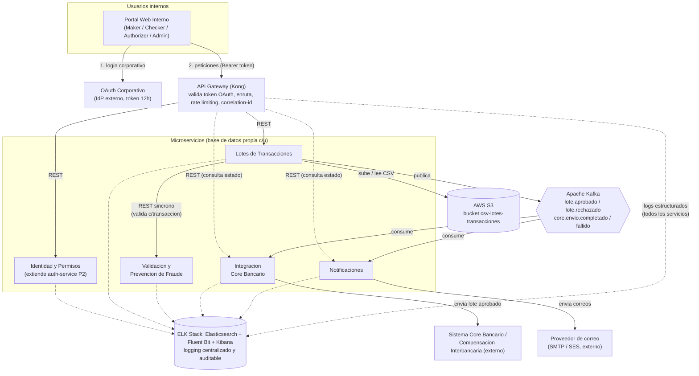
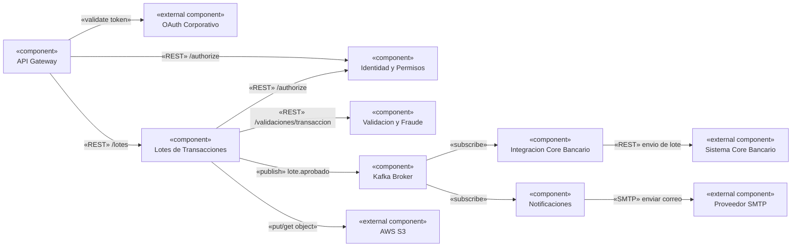

# Práctica 3 — Diseño de Arquitectura: Sistema Bancario de Procesamiento de Transacciones

Práctica del curso Software Avanzado (USAC), sección B, carné 201800678.

Diseño de arquitectura de microservicios para reemplazar el sistema monolítico de procesamiento
de transacciones de una institución bancaria, que se vuelve lento en picos de demanda (fin de
mes, planillas masivas, temporadas de impuestos). Esta práctica es de **diseño**, no de
implementación: el entregable es documentación y diagramas, no una aplicación corriendo.

## Contenido de este repositorio

```
P3/
├── README.md                              # este documento: arquitectura general, tecnologias, patrones
├── PROMPTS.md
├── Practica_3_2S2026.pdf                    # enunciado original
└── docs/
    ├── microservicios/
    │   ├── 01-identidad-permisos.md          # extiende el auth-service de P2
    │   ├── 02-lotes-transacciones.md         # CSV, flujo de aprobacion, historial
    │   ├── 03-validacion-fraude.md
    │   ├── 04-integracion-core-bancario.md
    │   └── 05-notificaciones.md
    ├── flujo-aprobacion.md                    # maker-checker-authorizer + 3 diagramas de secuencia
    └── diagramas/
        └── drawio/                            # mismos diagramas en formato .drawio (Draw.io)
            ├── 01-arquitectura-y-componentes.drawio
            ├── 02-diagramas-er.drawio           (5 paginas, una por microservicio)
            ├── 03-diagramas-clases.drawio        (5 paginas, una por microservicio)
            └── 04-diagramas-secuencia.drawio     (3 paginas, una por flujo critico)
```

Cada diagrama existe en dos formatos equivalentes: **Mermaid** embebido en los `.md` (se
renderiza directamente en GitHub/VSCode) y **Draw.io** en `docs/diagramas/drawio/` (para edición
visual). Los diagramas ER y de clases, al ser específicos de cada microservicio, están dentro del
documento de ese microservicio en vez de repetidos aquí.

## Resumen del problema

El sistema actual procesa transacciones (transferencias, pagos y depósitos masivos, cargados vía
CSV) en un monolito, lo que provoca degradación de rendimiento en picos de demanda. La solución
propuesta separa las responsabilidades en microservicios independientes, cada uno con su propia
base de datos, comunicados por REST (para operaciones que requieren respuesta inmediata) y
mensajería asíncrona (para efectos posteriores a la aprobación que no deben bloquear al usuario).

## Arquitectura general



## Diagrama de componentes

Vista lógica de las interfaces provistas/requeridas entre componentes (complementa la vista física
de arriba, que incluye infraestructura como Kafka/S3/ELK como nodos de despliegue):



Diagramas equivalentes en Draw.io: `docs/diagramas/drawio/01-arquitectura-y-componentes.drawio`
(2 páginas).

## Microservicios

| Servicio | Responsabilidad | Documento |
|---|---|---|
| Identidad y Permisos | Extiende el `auth-service` de P2: mapea identidad OAuth corporativa a rol interno (MAKER/CHECKER/AUTHORIZER/ADMIN) y resuelve autorización | [`docs/microservicios/01-identidad-permisos.md`](docs/microservicios/01-identidad-permisos.md) |
| Lotes de Transacciones | Carga de CSV, máquina de estados del flujo de aprobación, historial consultable/descargable | [`docs/microservicios/02-lotes-transacciones.md`](docs/microservicios/02-lotes-transacciones.md) |
| Validación y Prevención de Fraude | Reglas de negocio por transacción: saldo, límites, cuenta válida, fraude | [`docs/microservicios/03-validacion-fraude.md`](docs/microservicios/03-validacion-fraude.md) |
| Integración Core Bancario | Adaptador hacia el sistema core bancario externo, con reintentos/backoff | [`docs/microservicios/04-integracion-core-bancario.md`](docs/microservicios/04-integracion-core-bancario.md) |
| Notificaciones | Envío de correo a beneficiarios tras la aprobación final | [`docs/microservicios/05-notificaciones.md`](docs/microservicios/05-notificaciones.md) |

Cada documento incluye responsabilidad, endpoints, diagrama ER y diagrama de clases UML
(atributos y relaciones) de ese servicio.

## Integración con la Práctica 2 y reglas de negocio

La autenticación primaria la resuelve el **OAuth corporativo** (externo, token de 12 horas). La
**autorización** — decidir qué puede hacer cada usuario dentro de este sistema — reutiliza
directamente el `auth-service` construido en la Práctica 2: mismo contrato
`POST /authorize { token, rolesPermitidos } → { allowed }`, mismo patrón de reintentos con
backoff configurable, mismo cifrado AES de datos personales — extendido únicamente en su catálogo
de roles (de `admin`/`cliente` a `MAKER`/`CHECKER`/`AUTHORIZER`/`ADMIN`). Detalle completo en
[`docs/microservicios/01-identidad-permisos.md`](docs/microservicios/01-identidad-permisos.md).

Las reglas de negocio del enunciado están reflejadas así:

| Regla del enunciado | Dónde se refleja |
|---|---|
| Validación de CSV (saldo, límites, cuentas, fraude) | Servicio de Validación y Prevención de Fraude, invocado síncronamente al cargar el lote |
| Flujo de aprobación de 3 pasos | Máquina de estados en Lotes de Transacciones — ver [`docs/flujo-aprobacion.md`](docs/flujo-aprobacion.md) |
| Correo a beneficiarios al aprobar | Servicio de Notificaciones, consumidor del evento `lote.aprobado` |
| Historial consultable y descargable | `GET /lotes`, `GET /lotes/{id}`, `GET /lotes/{id}/descargar` en Lotes de Transacciones |
| Logging centralizado y auditable | ELK Stack (ver sección siguiente) + `RegistroAcceso`/`HistorialEstadoLote` a nivel de negocio |

## Estrategia de almacenamiento de archivos CSV

**AWS S3**, un bucket dedicado (`csv-lotes-transacciones`) particionado por fecha
(`YYYY/MM/DD/{lote_id}.csv`). El servicio de Lotes de Transacciones sube el archivo original al
cargarlo y guarda solo la referencia (`ruta_csv_s3`) en su base de datos — nunca el contenido
completo del archivo en la base de datos relacional. La descarga desde el historial
(`GET /lotes/{id}/descargar`) se resuelve con una **URL firmada (presigned URL)** de corta
duración, para no exponer el bucket públicamente ni proxear el archivo a través del backend.
Versionado de bucket activado, como respaldo ante sobrescritura accidental.

## Estrategia de logging centralizado

**ELK Stack** (Elasticsearch + Fluent Bit + Kibana), elegido sobre alternativas más livianas
(ej. Grafana Loki) porque el requisito es explícitamente "auditable": Elasticsearch ofrece
búsqueda de texto completo y retención indexada de largo plazo, más adecuado para consultas de
cumplimiento/auditoría que un modelo basado solo en etiquetas de líneas de log. Cada
microservicio (y el API Gateway) emite logs estructurados en JSON con `correlation_id` (propagado
desde el Gateway en cada petición para poder rastrear una operación de punta a punta a través de
varios servicios), `service_name`, `timestamp`, `level` y `event_type`. Fluent Bit los recolecta
como agente y los envía a Elasticsearch; Kibana se usa para búsqueda y dashboards. Los eventos de
negocio críticos (cada paso del flujo de aprobación, envíos al core bancario, notificaciones)
además quedan en un índice de auditoría con retención extendida, distinto del índice de logs
técnicos de aplicación.

## Comunicación entre servicios

- **REST síncrono**: para operaciones donde el usuario espera una respuesta inmediata (cargar
  CSV, aprobar/rechazar un paso, consultar/descargar el historial) y para la validación de cada
  transacción al momento de la carga (Lotes → Validación), donde el Maker necesita feedback
  inmediato de qué filas fallaron.
- **Mensajería asíncrona (Apache Kafka)**: para efectos posteriores a la aprobación que no deben
  bloquear al usuario ni acoplar a Lotes de Transacciones con sus consumidores — envío al core
  bancario y notificación a beneficiarios. Se eligió Kafka sobre RabbitMQ/NATS por tres razones
  concretas para este caso bancario: (1) el log de eventos es duradero y replayable, valioso para
  auditoría y para reconstruir estado ante un incidente; (2) desacopla totalmente productor de
  consumidores (Integración Core Bancario y Notificaciones ni se enteran uno del otro); (3)
  particionando por `lote_id` se garantiza el orden de los eventos de un mismo lote sin necesitar
  coordinación adicional.

## Propuesta de API Gateway

**Kong** (open-source, auto-hospedable), responsable de: enrutamiento hacia cada microservicio,
validación de la firma/expiración del token OAuth corporativo (plugin JWT / OAuth2), rate
limiting para proteger los servicios en picos de demanda (el problema original que motiva esta
práctica), inyección de un `correlation_id` por petición para trazabilidad en el logging
centralizado, y terminación TLS. Se prefirió sobre un API Gateway nativo de un solo proveedor
cloud (ej. AWS API Gateway) para no acoplar el punto de entrada del sistema a un vendor
específico, mientras que el almacenamiento (S3) sí es un servicio gestionado donde ese
acoplamiento es aceptable y esperado.

## Tecnologías y patrones — justificación

| Decisión | Patrón / tecnología | Por qué |
|---|---|---|
| Un servicio, una responsabilidad | Arquitectura de microservicios | Permite escalar de forma independiente el servicio que más sufre en picos de demanda (Lotes de Transacciones) sin escalar todo el monolito |
| Una base de datos por servicio | Database-per-service | Evita acoplamiento a nivel de esquema; cada equipo/servicio puede evolucionar su modelo sin coordinar migraciones con los demás |
| Envío al core bancario | Adapter | Aísla el resto del sistema de los detalles del sistema externo; si cambia, solo se modifica un servicio |
| Consulta de roles | Reintentos con backoff (reutilizado de P2) | Tolera fallas temporales de un servicio del que depende una decisión de autorización, sin fallar de inmediato |
| Aprobación → efectos posteriores | Publicación de eventos (event-driven) | Desacopla Lotes de Transacciones de sus consumidores; ninguno bloquea al usuario que aprueba |
| Control de 3 personas distintas | Maker-Checker-Authorizer (four-eyes principle) | Control estándar de la industria bancaria para reducir riesgo de fraude interno |
| Entrada única al sistema | API Gateway | Punto centralizado para autenticación, rate limiting y trazabilidad, sin duplicar esa lógica en cada microservicio |

## Decisiones de diseño y trade-offs

- **Consistencia eventual, no transacciones distribuidas**: al aprobar un lote, el envío al core
  bancario y la notificación ocurren de forma asíncrona y pueden fallar independientemente uno del
  otro (ej. el correo falla pero el envío al core tiene éxito). Se aceptó deliberadamente esta
  consistencia eventual en vez de intentar una transacción distribuida (2PC) entre servicios,
  porque coordinar una transacción síncrona entre 3 servicios y un sistema externo introduciría
  acoplamiento y un único punto de fallo que contradice el objetivo original (tolerar picos de
  demanda). El estado de cada intento queda registrado (`SolicitudEnvioCore`, `Notificacion`) para
  reconciliación manual o automatizada posterior.
- **Idempotencia de los consumidores Kafka**: tanto Integración Core Bancario como Notificaciones
  deben tratar la posibilidad de recibir el mismo evento `lote.aprobado` más de una vez (reintentos
  del propio broker, rebalanceo de consumidores) sin duplicar el envío al banco ni reenviar
  correos — se diseñan como idempotentes usando `lote_id` como clave de deduplicación.
- **Duplicación controlada de datos en eventos**: el evento `lote.aprobado` incluye la lista de
  beneficiarios en el propio payload, en vez de que Notificaciones consulte la base de datos de
  Lotes de Transacciones. Es una violación menor de "una sola fuente de verdad" a cambio de
  desacople real entre servicios — trade-off estándar en arquitecturas orientadas a eventos.
- **Docker/Kubernetes (opcional, valorado)**: cada microservicio se empaquetaría como una imagen
  Docker independiente (siguiendo el mismo patrón multi-servicio de `docker-compose` ya usado en
  la Práctica 2), desplegado en Kubernetes con un Horizontal Pod Autoscaler orientado a CPU/latencia
  sobre el servicio de Lotes de Transacciones y el API Gateway — los dos componentes que reciben
  la carga directa de usuarios en los picos de demanda descritos en el enunciado.

## Nota sobre los entregables

La sección 4 ("Entregables") del enunciado original hace referencia a "carpeta P1" y a una
explicación de los 5 principios SOLID, que corresponde al formato de las prácticas de código
(P1/P2) y no aplica a esta práctica de diseño de arquitectura (sin código fuente). Esta
documentación sigue en su lugar la rúbrica detallada de la sección 8, específica de esta práctica.
