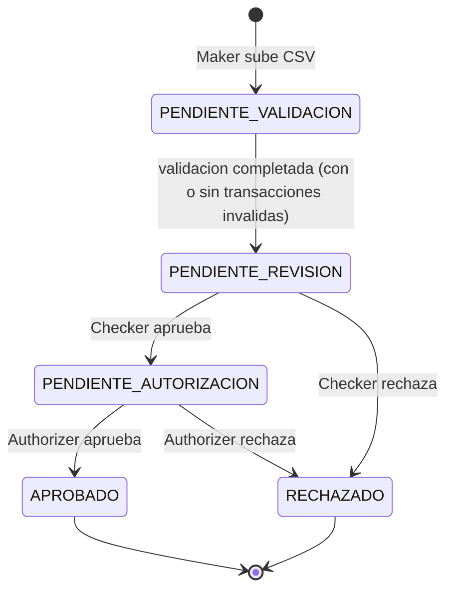
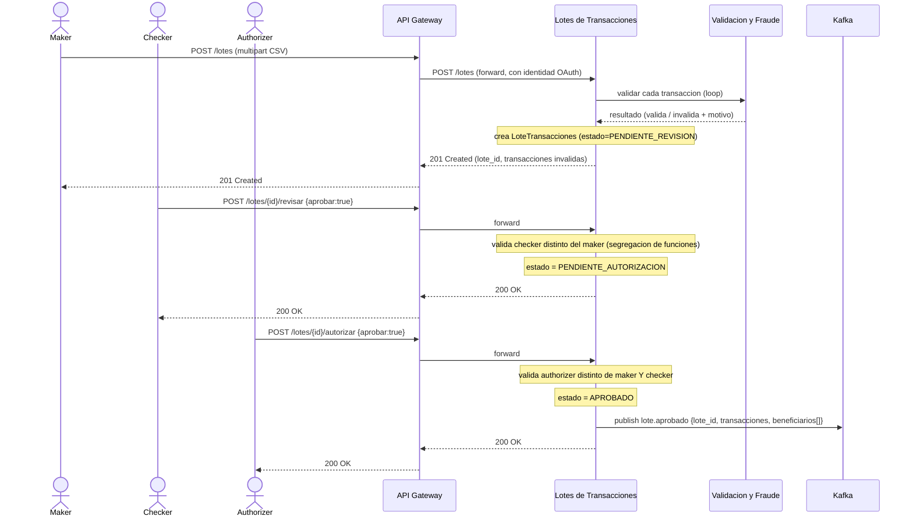
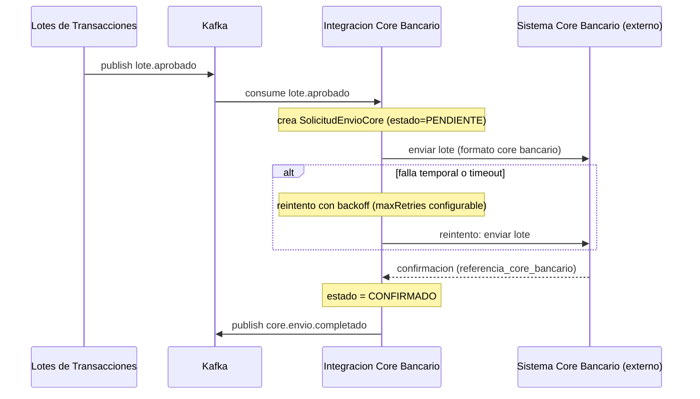
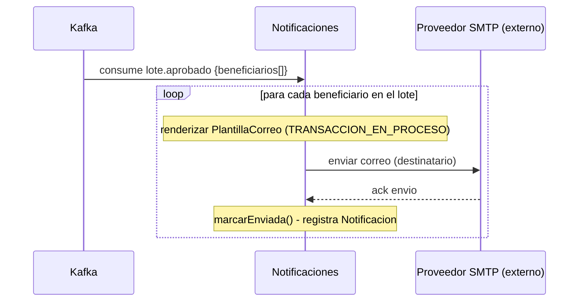

# Flujo de aprobación de 3 pasos (maker-checker-authorizer)

## Definición

Todo lote de transacciones cargado vía CSV debe pasar por tres decisiones humanas, tomadas por
tres usuarios **distintos**, antes de ser enviado al sistema core bancario:

1. **Maker (Elaborador)** — sube el archivo CSV con las transacciones (transferencias masivas,
   pagos en lote). El sistema valida formato y reglas de negocio de cada transacción de inmediato
   (servicio de Validación y Prevención de Fraude), marcando como inválida cualquier fila que no
   cumpla (saldo, límites, cuenta, fraude), sin rechazar el lote completo.
2. **Checker (Revisor)** — revisa el lote (incluyendo las transacciones marcadas inválidas) y
   decide si aprueba pasar a autorización o si rechaza el lote completo.
3. **Authorizer (Autorizador)** — da la autorización final. Al aprobar, el lote queda `APROBADO`
   y dispara, en paralelo y de forma asíncrona, el envío al core bancario y la notificación a los
   beneficiarios.

## Regla de segregación de funciones

El sistema exige que `usuario_maker_id`, `usuario_checker_id` y `usuario_authorizer_id` sean tres
personas distintas — un mismo usuario no puede cargar, revisar y autorizar su propio lote. Esta
regla se valida en el servicio de Lotes de Transacciones en cada transición de estado, consultando
al servicio de Identidad y Permisos tanto para confirmar el rol requerido (`CHECKER` o
`AUTHORIZER`) como para comparar la identidad contra los usuarios de los pasos anteriores del
mismo lote. Es un control estándar de la industria bancaria (four-eyes principle) para reducir el
riesgo de fraude interno.

## Máquina de estados del lote

## Diagrama de secuencia — Aprobación de 3 pasos

## Diagrama de secuencia — Envío al sistema core bancario

Disparado por el mismo evento `lote.aprobado`, de forma independiente al flujo anterior:

## Diagrama de secuencia — Notificación a clientes

También disparado por `lote.aprobado`, en paralelo al envío al core bancario:

## Por qué estos dos consumidores no bloquean el flujo de aprobación

Tanto el envío al core bancario como la notificación son **efectos posteriores** a la aprobación,
no parte de ella: el Authorizer recibe su `200 OK` en cuanto el lote queda `APROBADO` y el evento
se publicó en Kafka — no espera a que el core bancario responda ni a que se terminen de enviar los
correos. Si el envío al core falla temporalmente (reintentos agotados) o un correo no se puede
entregar, eso queda registrado en el estado propio de cada servicio (`SolicitudEnvioCore.estado`,
`Notificacion.estado_envio`) para investigación, sin afectar la experiencia de quien autorizó el
lote ni el estado del lote en sí (que ya es `APROBADO`, un hecho consumado del flujo de negocio).

Diagramas equivalentes en Draw.io: `docs/diagramas/drawio/04-diagramas-secuencia.drawio` (3
páginas, una por flujo).
