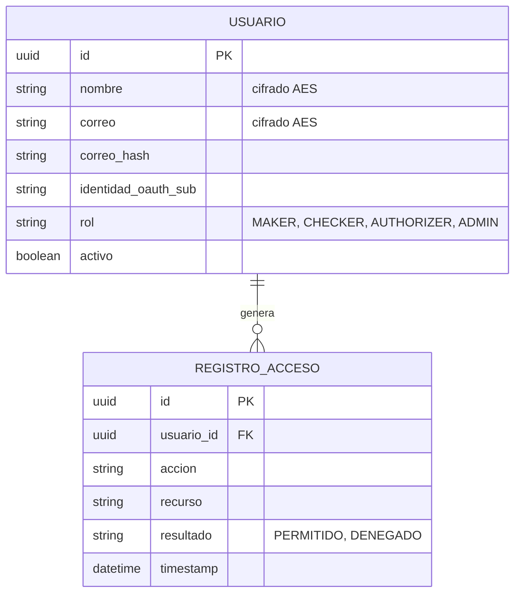
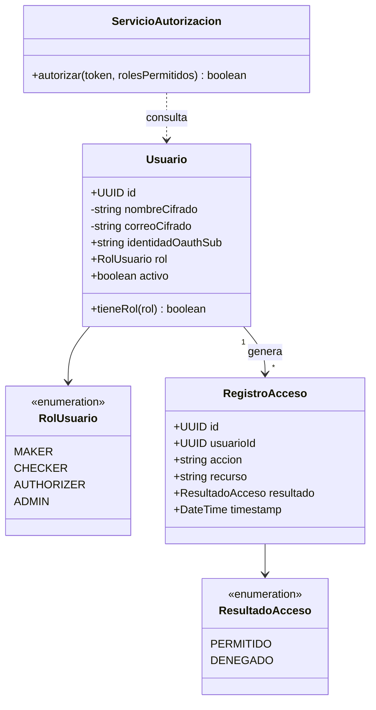

# Servicio de Identidad y Permisos

## Responsabilidad

Gestiona quién es cada usuario dentro del sistema (mapeo a su identidad corporativa OAuth) y qué
rol tiene dentro del flujo de aprobación (`MAKER`, `CHECKER`, `AUTHORIZER`, `ADMIN`). No emite
credenciales de autenticación primaria — eso lo hace el **OAuth Corporativo** externo (token de
12 horas) — sino que resuelve la pregunta de **autorización**: dado un token ya autenticado, ¿qué
puede hacer este usuario?

Este servicio **extiende el `auth-service` construido en la Práctica 2** (el microservicio
independiente de autorización, consultado con reintentos y backoff): se reutiliza exactamente el
mismo contrato `POST /authorize { token, rolesPermitidos } → { allowed }`, y el mismo patrón de
cifrado AES para datos personales (nombre, correo). Lo único que cambia es el catálogo de roles:
en P2 eran `admin`/`cliente`; aquí son los roles del esquema maker-checker-authorizer.

## Integración con la Práctica 2 y con OAuth Corporativo

1. El usuario se autentica una vez al día (token válido 12h) contra el **IdP corporativo**
   (fuera del alcance de este sistema — es infraestructura ya existente en el banco).
2. El API Gateway valida la firma/expiración de ese token OAuth en cada petición.
3. Para decidir si la acción solicitada está permitida (ej. "¿puede este usuario autorizar este
   lote?"), el Gateway (o el propio microservicio de negocio) llama a
   `POST /authorize` de este servicio — el mismo mecanismo de retry/backoff configurable que ya
   se implementó y probó en P2 para tolerar fallas temporales de este servicio.
4. Este servicio mantiene la tabla `Usuario`, vinculando `identidad_oauth_sub` (el `sub` claim
   del token corporativo) con el `rol` interno del sistema — esa asociación la administra un
   `ADMIN` (mismo flujo de gestión de usuarios de P2, extendido con este campo nuevo).

## Endpoints principales

| Método | Ruta | Descripción |
|---|---|---|
| POST | `/usuarios` | Crea/vincula un usuario interno a una identidad OAuth y le asigna un rol (solo `ADMIN`) |
| GET | `/usuarios/{id}` | Consulta un usuario |
| POST | `/authorize` | Heredado de P2: `{ token, rolesPermitidos } → { allowed }`, con reintentos desde el llamador |

## Diagrama ER

`REGISTRO_ACCESO` es la auditoría propia de este servicio (cada decisión de `/authorize` queda
registrada) — complementa, a nivel de negocio, el logging técnico centralizado (ver
`README.md`, sección de logging).

## Diagrama de clases UML

## Base de datos

PostgreSQL propia de este servicio (independiente de las demás), continuando el mismo motor
usado en P1/P2.

Diagramas equivalentes en Draw.io: `docs/diagramas/drawio/02-diagramas-er.drawio` (página
"ER - Identidad y Permisos") y `docs/diagramas/drawio/03-diagramas-clases.drawio` (página
"Clases - Identidad y Permisos").
