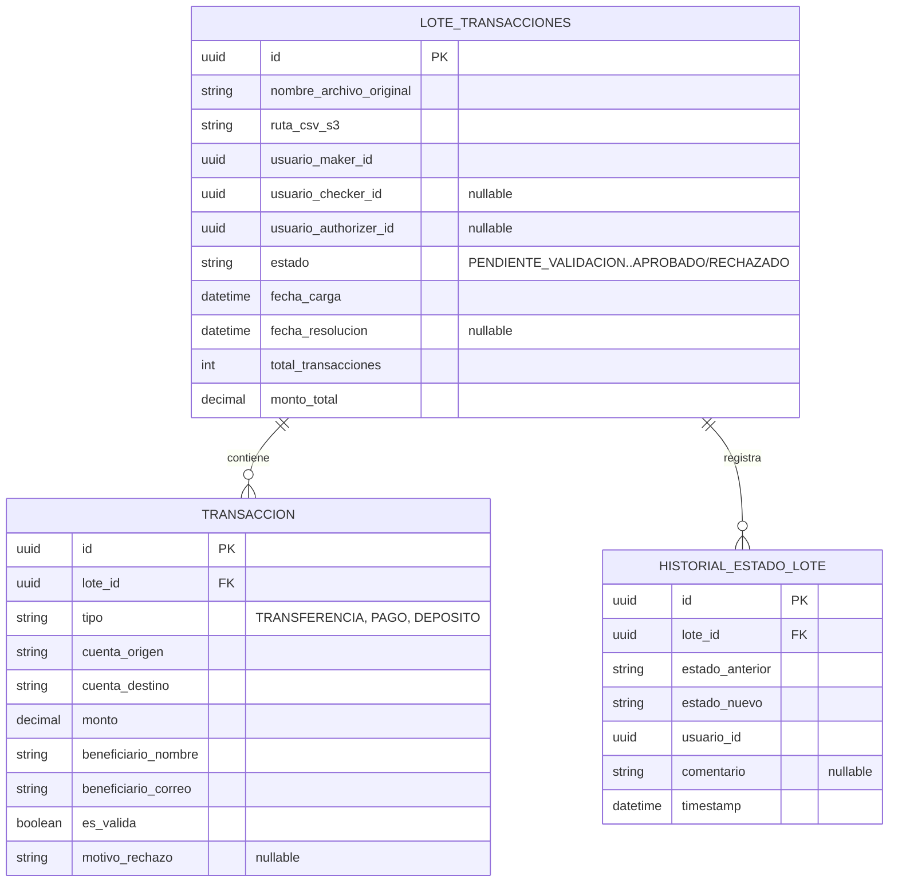
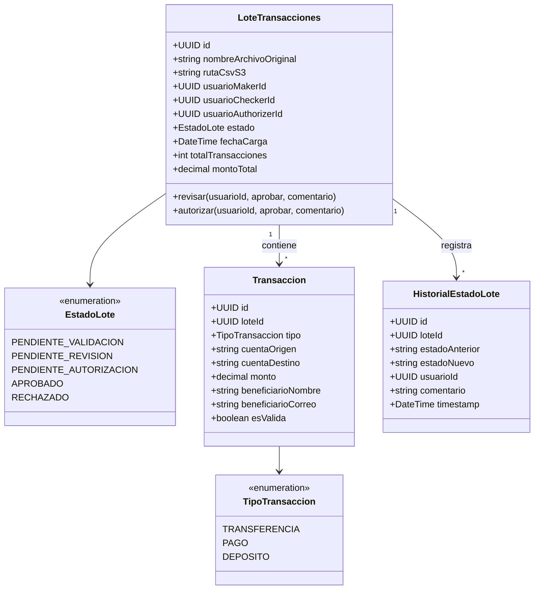

# Servicio de Lotes de Transacciones

## Responsabilidad

Es el servicio central del sistema: recibe la carga de archivos CSV con transferencias/pagos
masivos, orquesta el flujo de aprobación de 3 pasos (maker-checker-authorizer), y mantiene el
historial consultable y descargable de todos los lotes procesados. No decide por sí mismo si una
transacción es válida (eso lo delega al servicio de Validación y Prevención de Fraude) ni envía
nada al banco externo (eso lo hace, de forma desacoplada vía evento, el servicio de Integración
Core Bancario) — su responsabilidad es exclusivamente el ciclo de vida del lote y la máquina de
estados del flujo de aprobación.

## Reglas de negocio reflejadas

- **Segregación de funciones**: `usuario_maker_id`, `usuario_checker_id` y
  `usuario_authorizer_id` deben ser tres usuarios distintos. Se valida en cada paso consultando
  el rol (vía el servicio de Identidad y Permisos) y comparando explícitamente contra los
  usuarios de los pasos anteriores del mismo lote.
- Un lote solo avanza de `PENDIENTE_REVISION` a `PENDIENTE_AUTORIZACION` a `APROBADO` de forma
  estrictamente secuencial; no hay salto de pasos.
- Las transacciones que fallan la validación de negocio (ver servicio de Validación) quedan
  marcadas `es_valida=false` con `motivo_rechazo`, pero **no bloquean** el resto del lote — el
  Checker decide si el lote continúa solo con las transacciones válidas.
- Al llegar a `APROBADO` (paso 3), se publica el evento `lote.aprobado` en Kafka — es el único
  punto de integración con el resto del sistema; este servicio no sabe ni le importa quién
  consume ese evento (así se logra el desacople con Integración Core Bancario y Notificaciones).

## Endpoints principales

| Método | Ruta | Rol requerido | Descripción |
|---|---|---|---|
| POST | `/lotes` | MAKER | Sube un CSV, crea el lote y sus transacciones, valida cada una contra el servicio de Validación |
| GET | `/lotes` | cualquiera autenticado | Lista lotes (filtros: estado, fecha, usuario) — historial consultable |
| GET | `/lotes/{id}` | cualquiera autenticado | Detalle del lote: transacciones + historial de estados |
| GET | `/lotes/{id}/descargar` | cualquiera autenticado | URL firmada de S3 para descargar el CSV original |
| POST | `/lotes/{id}/revisar` | CHECKER | Aprueba o rechaza el paso 2 |
| POST | `/lotes/{id}/autorizar` | AUTHORIZER | Aprueba o rechaza el paso 3; si aprueba, publica `lote.aprobado` |

## Diagrama ER

## Diagrama de clases UML

## Base de datos

PostgreSQL propia. `ruta_csv_s3` es solo la referencia (key del objeto); el archivo físico vive en
AWS S3 (ver estrategia de almacenamiento en `README.md`).

Diagramas equivalentes en Draw.io: página "ER - Lotes de Transacciones" y
"Clases - Lotes de Transacciones" en los archivos correspondientes de
`docs/diagramas/drawio/`. El flujo de aprobación completo, con su diagrama de secuencia, está
documentado en `docs/flujo-aprobacion.md`.
