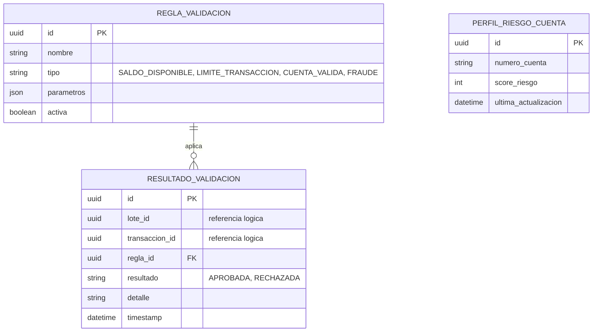
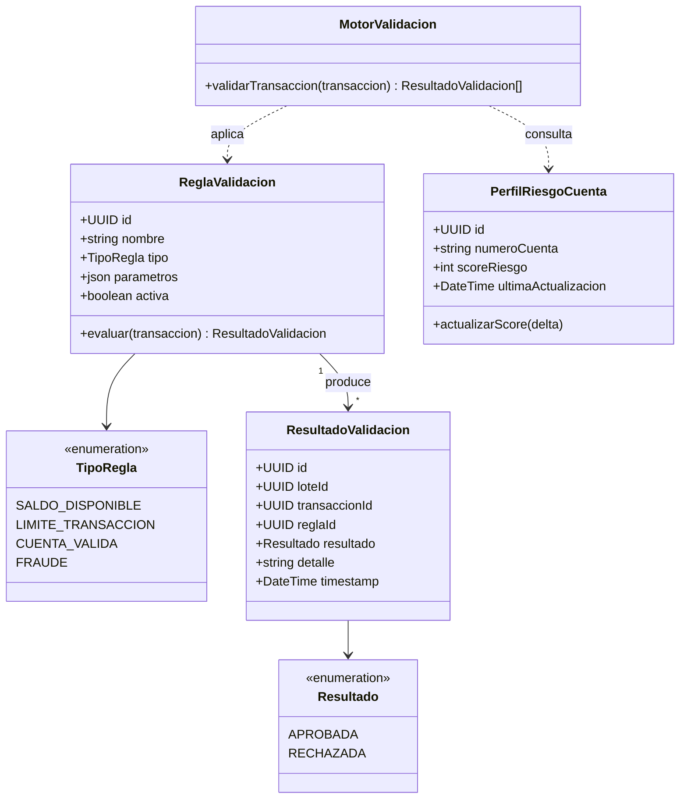

# Servicio de Validación y Prevención de Fraude

## Responsabilidad

Aplica las reglas internas del negocio a cada transacción individual de un lote recién cargado:
saldo disponible, límites de transacción, validez de la cuenta destino, y heurísticas de
prevención de fraude (velocidad de transacciones, montos atípicos respecto al perfil histórico de
la cuenta). Se separó del servicio de Lotes de Transacciones deliberadamente: las reglas de
negocio y los modelos de riesgo cambian con una cadencia y una propiedad (equipo de
riesgo/cumplimiento) distintas a las del flujo operativo de aprobación, y este servicio puede
escalarse o ajustarse de forma independiente sin tocar el servicio que orquesta los lotes.

## Comunicación

Se invoca de forma **síncrona (REST)** desde Lotes de Transacciones, una vez por transacción, en
el momento de la carga del CSV — el Maker necesita ver de inmediato qué filas fallaron antes de
que el lote pase a revisión. No participa de la mensajería asíncrona del resto del flujo.

## Endpoints principales

| Método | Ruta | Descripción |
|---|---|---|
| POST | `/validaciones/transaccion` | Recibe una transacción, la evalúa contra todas las reglas activas, responde el resultado consolidado |
| GET | `/reglas` | Lista las reglas de validación activas (uso administrativo/auditoría) |

## Diagrama ER

`lote_id` y `transaccion_id` son referencias lógicas (no llaves foráneas físicas): pertenecen a la
base de datos de otro microservicio, y cada servicio es dueño exclusivo de su propio esquema
(principio de base de datos por servicio).

## Diagrama de clases UML

## Base de datos

PostgreSQL propia. `PERFIL_RIESGO_CUENTA` es la única tabla con estado persistente entre
evaluaciones (el score de riesgo se actualiza incrementalmente); `RESULTADO_VALIDACION` es
esencialmente un log de auditoría de cada decisión, útil tanto para explicarle al Checker por qué
una transacción quedó marcada inválida como para análisis posterior de fraude.

Diagramas equivalentes en Draw.io: página "ER - Validacion y Fraude" y
"Clases - Validacion y Fraude" en `docs/diagramas/drawio/`.
