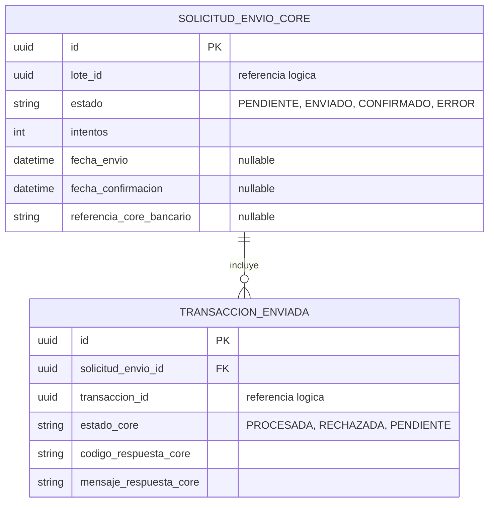
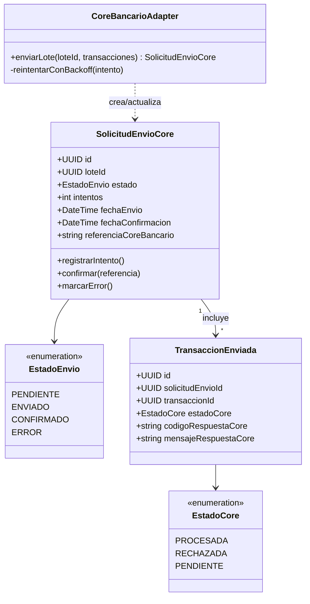

# Servicio de Integración con el Core Bancario

## Responsabilidad

Es el **adaptador (patrón Adapter)** entre este sistema y el sistema core bancario / de
compensación interbancaria externo. Aísla al resto de la arquitectura del protocolo, formato de
mensaje y particularidades de ese sistema externo (que el equipo no controla): si el core bancario
cambia su API o se reemplaza por otro proveedor, solo este servicio se ve afectado.

## Comunicación y tolerancia a fallos

Se activa de forma **asíncrona**: consume el evento `lote.aprobado` de Kafka (nunca es llamado
directamente por el flujo de aprobación, que no debe bloquearse esperando al sistema externo).
Reutiliza el mismo patrón de **reintentos con backoff configurable** implementado en el
`AuthorizationServiceClient` de la Práctica 2 para las llamadas al sistema core: ante una falla
temporal o timeout, reintenta hasta un máximo configurable antes de marcar el envío en estado
`ERROR` (visible en el historial para investigación manual), en vez de perder la transacción
silenciosamente.

## Endpoints principales

| Método | Ruta | Descripción |
|---|---|---|
| — | (consumidor Kafka `lote.aprobado`) | Dispara el envío del lote al sistema core |
| GET | `/envios/{lote_id}` | Consulta el estado de un envío (soporte/monitoreo) |
| — | (publica `core.envio.completado` / `core.envio.fallido`) | Notifica el resultado al resto del sistema |

## Diagrama ER

## Diagrama de clases UML

## Base de datos

PostgreSQL propia. Guarda su propio registro de intentos de envío — es la fuente de verdad para
reconciliar qué transacciones realmente llegaron al core bancario, independiente del estado que
mantiene el servicio de Lotes.

Diagramas equivalentes en Draw.io: página "ER - Integracion Core Bancario" y
"Clases - Integracion Core Bancario" en `docs/diagramas/drawio/`.
