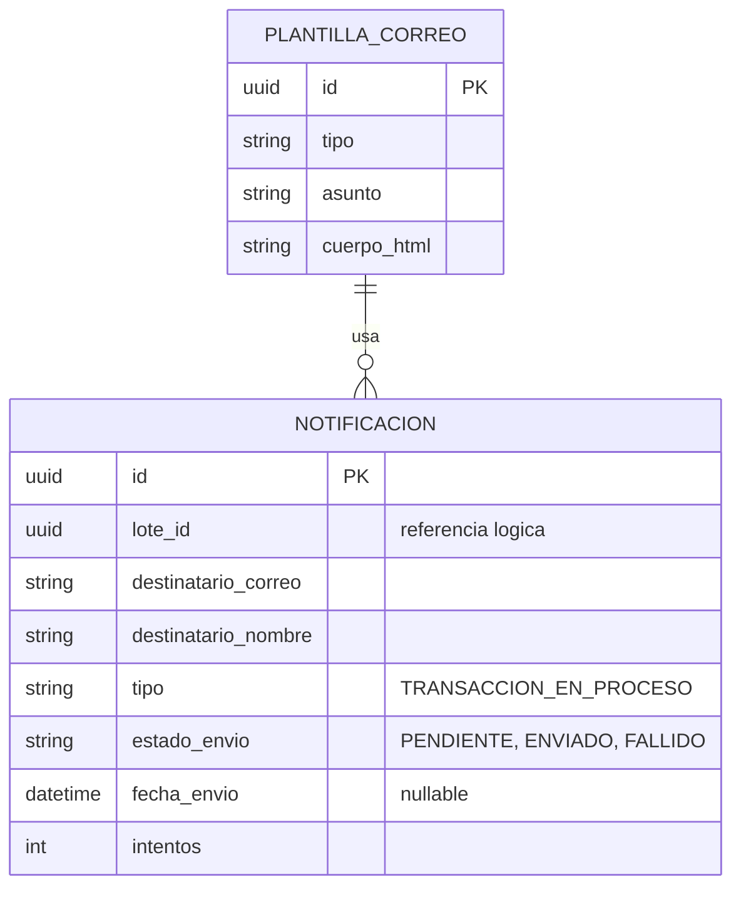
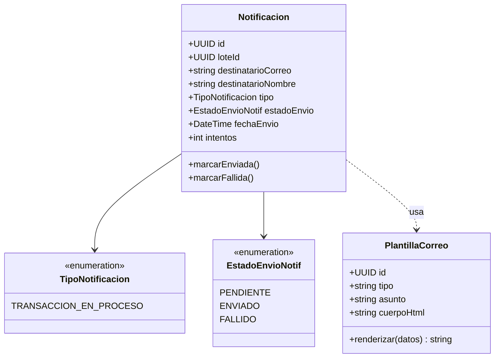

# Servicio de Notificaciones

## Responsabilidad

Envía el correo electrónico a cada beneficiario incluido en un lote, una vez que ese lote completó
el paso 3 (autorización final) del flujo de aprobación — cumple el requisito explícito del
enunciado: "informar que su transacción está en proceso". Se separó como su propio microservicio
porque el envío de correo tiene una tasa de fallo y una latencia distintas al resto del sistema
(depende de un proveedor externo), y no debe poder retrasar ni bloquear el flujo de aprobación ni
el envío al core bancario.

## Comunicación

Puramente **asíncrona**: consume el evento `lote.aprobado` de Kafka. El payload del evento incluye
la lista mínima de beneficiarios (`correo`, `nombre`) para que este servicio no necesite conocer
ni consultar el modelo de datos de Lotes de Transacciones — mantiene el desacople total entre
ambos servicios, a costa de una pequeña duplicación de datos en el evento (trade-off deliberado,
ver `README.md`, sección de decisiones de diseño).

## Endpoints principales

| Método | Ruta | Descripción |
|---|---|---|
| — | (consumidor Kafka `lote.aprobado`) | Dispara el envío de correos a los beneficiarios del lote |
| GET | `/notificaciones?lote_id=` | Consulta el estado de los envíos de un lote (soporte) |

## Diagrama ER

## Diagrama de clases UML

## Base de datos

PostgreSQL propia. Guarda el estado de cada envío individual — es la fuente de verdad para
soporte ("¿le llegó el correo a este beneficiario?") sin depender de los logs del proveedor SMTP.

Diagramas equivalentes en Draw.io: página "ER - Notificaciones" y "Clases - Notificaciones" en
`docs/diagramas/drawio/`.
