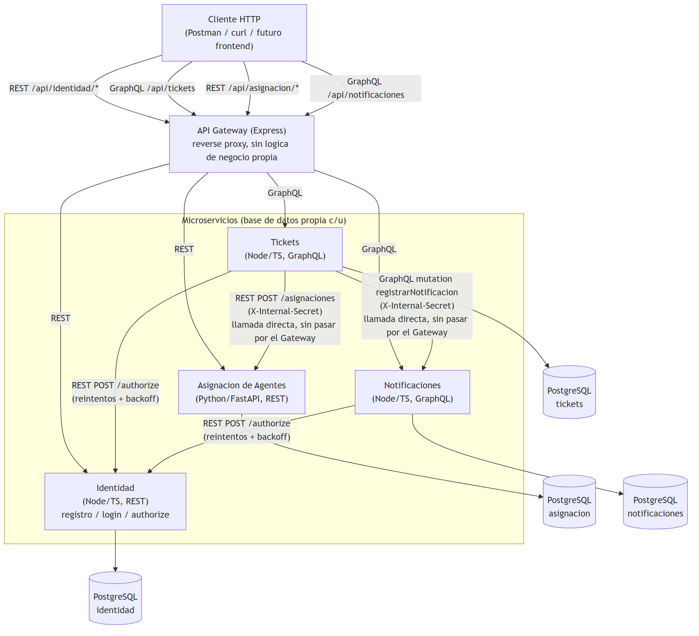

# Practica 4 — Mesa de Ayuda: Arquitectura de Microservicios

Practica del curso Software Avanzado (USAC), seccion B, carne 201800678.

Sistema de mesa de ayuda / tickets de soporte, de tematica libre (a diferencia de P3, que era
diseno bancario), implementado como 4 microservicios independientes mas un API Gateway,
contenedorizados con Docker Compose. A diferencia de P3 (que fue solo diseno), esta practica exige
**implementacion funcional**: cada microservicio responde peticiones reales sobre su propia base de
datos PostgreSQL.

**Estado actual:** funcional. Los 4 microservicios y el Gateway compilan sin errores
(`tsc --noEmit` en los 4 servicios Node, `python -m py_compile` en el servicio Python) y el flujo
completo (registro -> login -> crear ticket -> asignacion automatica -> notificacion -> resolucion)
esta verificado de extremo a extremo via `docker compose up`. Ver `docs/` para diagramas y detalle
de cada microservicio, y [`MANUAL_USUARIO.md`](MANUAL_USUARIO.md) para instrucciones paso a paso de
como desplegar y probar toda la practica (incluye ejemplos `curl` de cada flujo).

## Microservicios

| Servicio | Lenguaje | Protocolo | Responsabilidad | Documento |
|---|---|---|---|---|
| Identidad | Node/TS | REST | Registro, login, autorizacion por roles (extiende el `auth-service` de P2) | [`docs/microservicios/01-identidad.md`](docs/microservicios/01-identidad.md) |
| Tickets | Node/TS | **GraphQL** | Ciclo de vida de los tickets de soporte | [`docs/microservicios/02-tickets.md`](docs/microservicios/02-tickets.md) |
| Asignacion de Agentes | **Python**/FastAPI | REST | Asigna el agente con menor carga por categoria | [`docs/microservicios/03-asignacion.md`](docs/microservicios/03-asignacion.md) |
| Notificaciones | Node/TS | **GraphQL** | Simula el envio de correo y guarda el historial | [`docs/microservicios/04-notificaciones.md`](docs/microservicios/04-notificaciones.md) |
| Gateway | Node/TS | REST + GraphQL (proxy) | Punto de entrada unico, enruta a los 4 servicios | — (ver abajo) |

Cumple los requisitos duros del enunciado: 4 microservicios (mas Gateway), 2 lenguajes distintos
(Node.js y Python), GraphQL en 2 servicios (Tickets y Notificaciones), Dockerfile individual por
servicio, `docker-compose.yml` unico, e integracion del servicio de autenticacion de P2 (ver
seccion siguiente).

## Diagramas

### Arquitectura — comunicación entre servicios



### Despliegue — contenedores, red y volúmenes de Docker Compose


Detalle y justificación de cada diagrama: [`docs/diagramas/01-arquitectura.md`](docs/diagramas/01-arquitectura.md)
y [`docs/diagramas/02-despliegue.md`](docs/diagramas/02-despliegue.md). Diagramas ER (uno por
microservicio, específico de su base de datos): dentro del documento de cada microservicio en
`docs/microservicios/`, mismo criterio que P3. Todos los diagramas son imágenes PNG renderizadas
desde su fuente Mermaid editable (`docs/diagramas/src/*.mmd`).

## Contratos de API

| Servicio | Formato | Donde |
|---|---|---|
| Identidad | OpenAPI/Swagger | [`identidad-service/openapi.yaml`](identidad-service/openapi.yaml), Swagger UI en `GET /docs` |
| Asignacion de Agentes | OpenAPI/Swagger (autogenerado) | `GET /docs` y `GET /openapi.json` (FastAPI lo deriva del propio codigo) |
| Tickets | SDL GraphQL | [`tickets-service/schema.graphql`](tickets-service/schema.graphql), Apollo Sandbox en `POST /graphql` |
| Notificaciones | SDL GraphQL | [`notificaciones-service/schema.graphql`](notificaciones-service/schema.graphql), Apollo Sandbox en `POST /graphql` |

Para los dos servicios REST se uso el formato pedido literalmente (Swagger/OpenAPI); para los dos
servicios GraphQL se uso su contrato nativo equivalente (SDL + Apollo Sandbox como documentacion
interactiva), que cumple el mismo proposito que Swagger para una API GraphQL.

Ademas, [`postman/P4-Mesa-de-Ayuda.postman_collection.json`](postman/P4-Mesa-de-Ayuda.postman_collection.json)
(+ [`postman/P4-Local.postman_environment.json`](postman/P4-Local.postman_environment.json)) es
una coleccion Postman completa con los 4 microservicios a traves del Gateway — 25 requests en 5
carpetas, con captura automatica de tokens/IDs entre requests, validada de punta a punta con
Newman (25/25 requests, 30/30 assertions). Ver la seccion "3.1 Coleccion de Postman" de
[`MANUAL_USUARIO.md`](MANUAL_USUARIO.md) para como importarla y correrla.

## Integracion con la Practica 2

La autenticacion/autorizacion de este sistema extiende directamente el `auth-service` de P2: mismo
patron de `POST /authorize { token, rolesPermitidos } -> { allowed }`, mismo mecanismo de JWT
firmado con `jsonwebtoken`, y el mismo principio de que **solo un microservicio conoce el secreto
de firma** — ningun otro decodifica el token por su cuenta. La diferencia es que en P4 el registro
y el login (que en P2 vivian en `backend/`) se fusionaron con el `authorize` verify-only en un
unico microservicio, `identidad-service`, porque P4 pide 4 microservicios de negocio, no una
separacion identidad/autorizacion en dos piezas. El catalogo de roles tambien cambio de
`admin`/`cliente` (P2) a `ADMIN`/`AGENTE`/`CLIENTE` (mesa de ayuda).

`/authorize` tambien se extendio para devolver los datos del usuario autenticado
(`{ allowed, usuario: { id, correo, rol } }`), no solo el booleano de P2: los microservicios de P4
(Tickets, Notificaciones) necesitan saber *quien* hizo la peticion para, por ejemplo, guardar el
`clienteId` de un ticket — cosa que P2 no necesitaba porque el propio backend ya decodificaba su
JWT localmente.

## Como levantar el proyecto

```
cp .env.example .env
docker compose up -d
```

Esto levanta los 9 contenedores (Gateway, 4 microservicios, 4 Postgres). Gateway en
`http://localhost:4000`; cada microservicio tambien accesible directo en su propio puerto
(`4100`/`4200`/`8000`/`4400`) para depuracion — ver `docs/diagramas/02-despliegue.md`.

## Cuentas creadas automaticamente

Al arrancar `identidad-service` por primera vez se siembran (idempotente, ver
`ADMIN_*`/`AGENTE1_*`/`AGENTE2_*` en `.env.example`):

| Rol | Correo | Contrasena |
|---|---|---|
| ADMIN | `admin@admin.com` | `Admin12345` |
| AGENTE (categoria SOFTWARE) | `agente.software@mesadeayuda.com` | `Agente12345` |
| AGENTE (categoria HARDWARE) | `agente.hardware@mesadeayuda.com` | `Agente12345` |

`asignacion-service` siembra por separado dos perfiles de agente (uno por categoria) con carga en
cero, para que la asignacion automatica sea demostrable sin pasos manuales. No comparten `id` con
las cuentas de Identidad (bases de datos distintas, ver nota en `docs/microservicios/02-tickets.md`).

## Flujo de prueba de extremo a extremo

1. `POST /api/identidad/registro` — crear una cuenta CLIENTE.
2. `POST /api/identidad/login` — obtener el JWT (`token`).
3. `POST /api/tickets` (GraphQL, header `Authorization: Bearer <token>`) — mutation `crearTicket`.
   Dispara: asignacion automatica de agente (`asignacion-service`) y notificacion
   `TICKET_ASIGNADO`/`TICKET_CREADO` (`notificaciones-service`).
4. Login como uno de los agentes sembrados -> mutation `actualizarEstadoTicket(id, RESUELTO)` ->
   dispara notificacion `TICKET_RESUELTO`.
5. Query `historialNotificaciones(ticketId)` (rol AGENTE/ADMIN) para ver el registro de envios.

## Principios SOLID

Evidencia real de codigo, en Node y en Python (para mostrar que el criterio no es especifico de un
solo lenguaje).

### SRP — Principio de Responsabilidad Unica

`identidad-service/src/application/use-cases/RegistrarUsuarioUseCase.ts` solo orquesta el registro:
valida que el correo no exista y delega el hashing/persistencia a sus dependencias; no sabe nada de
HTTP, SQL ni bcrypt concretos:

```ts
export class RegistrarUsuarioUseCase {
  constructor(
    private readonly usuarioRepository: IUsuarioRepository,
    private readonly passwordHasher: IPasswordHasher
  ) {}

  async execute(dto: RegistrarUsuarioDTO): Promise<Usuario> {
    const existente = await this.usuarioRepository.findByCorreo(dto.correo);
    if (existente) {
      throw new CorreoYaRegistradoError();
    }
    const usuario: Usuario = {
      id: randomUUID(),
      nombre: dto.nombre,
      correo: dto.correo,
      contrasenaHash: await this.passwordHasher.hash(dto.contrasena),
      rol: RolUsuario.CLIENTE,
    };
    return this.usuarioRepository.create(usuario);
  }
}
```

De forma simetrica, `AuthController` (`identidad-service/src/interfaces/http/controllers/`) solo
traduce HTTP <-> casos de uso; cada clase cambia por una razon distinta.

### OCP — Principio de Abierto/Cerrado

`identidad-service/src/interfaces/http/middlewares/errorHandler.ts` decide la respuesta HTTP segun
el *tipo* de error, apoyandose en la clase abstracta `DomainError`:

```ts
if (err instanceof DomainError) {
  res.status(err.statusCode).json({ error: err.message });
  return;
}
```

Los errores de dominio (`CorreoYaRegistradoError`, `CredencialesInvalidasError`,
`TokenInvalidoError`, y sus equivalentes en `tickets-service`/`notificaciones-service`:
`TicketNoEncontradoError`, `AccesoDenegadoError`, `SecretoInternoInvalidoError`, etc.) se agregan
sin tocar una sola linea de `errorHandler.ts`: esta *cerrado* a modificacion pero *abierto* a los
errores nuevos que se le sumen.

### LSP — Principio de Sustitucion de Liskov

En Python, `asignacion-service/app/infrastructure/repositories.py` implementa el puerto
`IAgenteRepository` (`app/domain/repositories.py`, una clase abstracta) respetando exactamente su
contrato:

```python
class SqlAlchemyAgenteRepository(IAgenteRepository):
    def __init__(self, db: Session) -> None:
        self._db = db

    def find_by_categoria_ordenados_por_carga(self, categoria: CategoriaTicket) -> list[Agente]:
        rows = (
            self._db.query(AgenteModel)
            .filter(AgenteModel.categoria == categoria.value, AgenteModel.activo.is_(True))
            .order_by(asc(AgenteModel.carga_actual))
            .all()
        )
        return [self._to_entity(row) for row in rows]
```

`AsignarAgenteUseCase` funciona igual sin importar que implementacion concreta reciba, siempre que
respete el contrato de `IAgenteRepository` — por ejemplo, en pruebas podria sustituirse por un
repositorio en memoria sin cambiar una sola linea de `app/application/use_cases.py`.

### ISP — Principio de Segregacion de Interfaces

En vez de una interfaz grande de "seguridad", `identidad-service/src/domain/services/IPasswordHasher.ts`
expone solo los dos metodos que el caso de uso de autenticacion necesita:

```ts
export interface IPasswordHasher {
  hash(textoPlano: string): Promise<string>;
  comparar(textoPlano: string, hash: string): Promise<boolean>;
}
```

El mismo criterio aplica a `IIdentidadServiceClient` (un solo metodo, `autorizar`),
`IAsignacionServiceClient` (un solo metodo, `asignarAgente`) e `INotificacionServiceClient` (un
solo metodo, `registrarNotificacion`) en `tickets-service` — cada puerto tiene exactamente lo que
su unico consumidor usa, nada de un "cliente HTTP generico" de mas.

### DIP — Principio de Inversion de Dependencias

`tickets-service/src/application/use-cases/CrearTicketUseCase.ts` depende unicamente de
abstracciones definidas en `domain/`, nunca de Postgres ni de los clientes HTTP concretos:

```ts
export class CrearTicketUseCase {
  constructor(
    private readonly ticketRepository: ITicketRepository,
    private readonly identidadServiceClient: IIdentidadServiceClient,
    private readonly asignacionServiceClient: IAsignacionServiceClient,
    private readonly notificacionServiceClient: INotificacionServiceClient
  ) {}
  // ...
}
```

La unica pieza de cada servicio que conoce las implementaciones concretas es su *composition root*
(`src/app.ts` en los servicios Node, `app/main.py` + `app/interfaces/routers.py` en
`asignacion-service`), donde se conectan las abstracciones con `PostgresTicketRepository`,
`IdentidadServiceClient`, `AsignacionServiceClient` y `NotificacionServiceClient` reales. El mismo
principio aplica en Python: `AsignarAgenteUseCase(agente_repository: IAgenteRepository)` recibe la
abstraccion por constructor, nunca instancia `SqlAlchemyAgenteRepository` directamente.

## Decisiones de diseno y trade-offs

- **bcrypt en vez de AES para la contrasena** (a diferencia de P2): P4 no exige que la contrasena
  sea recuperable en texto plano, asi que se uso hash de un solo sentido — mas seguro y sin
  necesidad de gestionar una clave simetrica.
- **Sin cola de mensajeria (Kafka/RabbitMQ)**: P4 no lo exige (a diferencia del diseno de P3). Los
  efectos posteriores a crear un ticket (asignar agente, notificar) se resuelven con llamadas REST/
  GraphQL directas y sincronas de Tickets hacia los otros dos servicios, aceptando consistencia
  eventual "manual" (un fallo se loguea, no bloquea ni revierte al cliente) en vez de un broker.
- **Secreto compartido servicio-a-servicio (`X-Internal-Secret`)** en `POST /asignaciones` y en la
  mutation `registrarNotificacion`: son operaciones que solo debe invocar `tickets-service`, no un
  usuario final. En vez de reimplementar la verificacion completa de JWT/roles de Identidad en un
  tercer lenguaje (Python) para una sola ruta interna, se protegen con un secreto simple — un
  trade-off deliberado entre seguridad exhaustiva y complejidad anadida, razonable para el alcance
  de esta practica.
- **Database-per-service real** (no solo "recomendado" en el enunciado): cada microservicio tiene
  su propio contenedor Postgres, sin llaves foraneas fisicas entre servicios (`clienteId`,
  `agenteId`, `ticketId` referenciados solo como valores, nunca como FK). Es el mismo trade-off de
  "duplicacion controlada" que P3 documento para su diseno, ahora implementado.
- **Gateway sin logica de autenticacion propia**: es un *reverse proxy* delgado
  (`http-proxy-middleware`), consistente con el patron ya usado en el diseno de P3 (Kong): centraliza
  el punto de entrada, pero la autorizacion vive en un solo lugar (Identidad).

## Notas de verificacion

`tsc --noEmit` sin errores en los 4 servicios Node (`identidad-service`, `tickets-service`,
`notificaciones-service`, `gateway`) y `python -m py_compile` sin errores en `asignacion-service`.
Flujo de extremo a extremo verificado con `docker compose up`: registro, login, creacion de ticket
con asignacion automatica de agente y notificacion, resolucion de ticket con notificacion de
resolucion, historial de notificaciones, y el caso de rol no autorizado (403) y token ausente
(401) a traves del Gateway.
