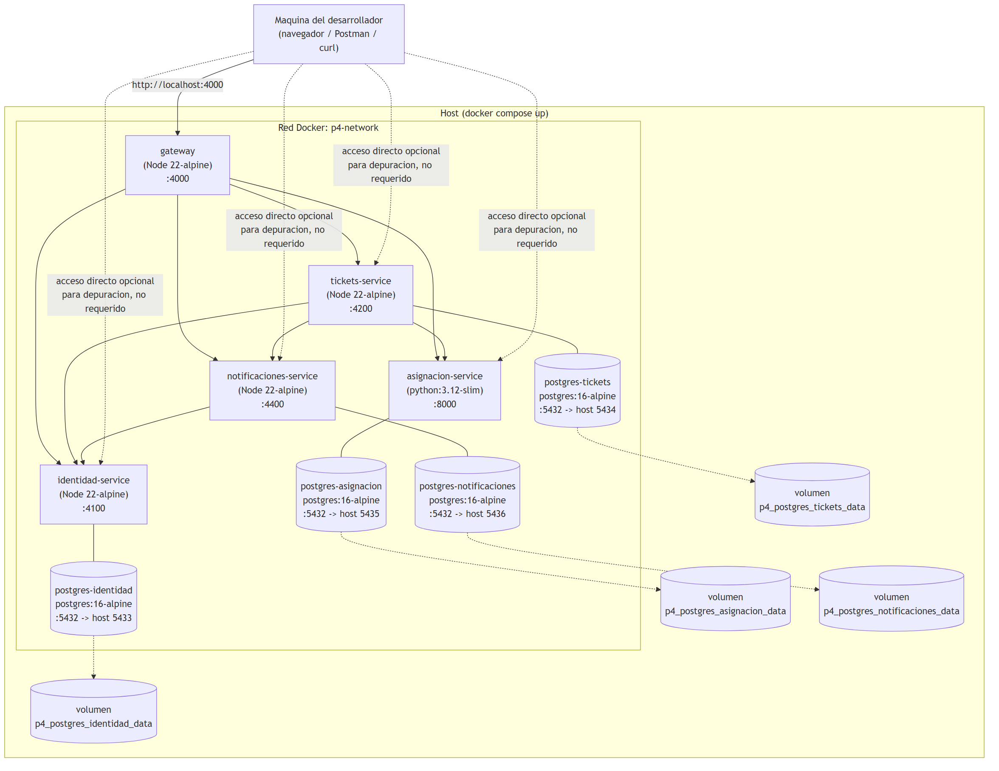

# Diagrama de despliegue

Todo el sistema se levanta con un solo comando (`docker compose up -d`): 9 contenedores en una
misma red de Docker (`p4-network`), cada microservicio con su propio contenedor de PostgreSQL
(database-per-service) y su propio volumen persistente.

Fuente editable (Mermaid): [`src/02-despliegue.mmd`](src/02-despliegue.mmd).

## Notas de despliegue

- **Un `Dockerfile` por microservicio** (`identidad-service/Dockerfile`, `tickets-service/Dockerfile`,
  `asignacion-service/Dockerfile`, `notificaciones-service/Dockerfile`, `gateway/Dockerfile`): los 4
  servicios Node comparten el mismo patrón de una sola etapa (`node:22-alpine`, `pnpm install`,
  bind-mount del código fuente para desarrollo con recarga automática); `asignacion-service` usa
  `python:3.12-slim` con `pip install -r requirements.txt` y `uvicorn --reload`.
- **Cada microservicio con base de datos propia** (database-per-service): las migraciones SQL de
  cada servicio se montan en `docker-entrypoint-initdb.d` de su propio contenedor Postgres, así que
  la tabla se crea automáticamente la primera vez que ese volumen se inicializa.
- **Puertos expuestos al host** (`.env`, ver `.env.example`) para poder probar cada microservicio
  directamente durante el desarrollo, aunque el punto de entrada esperado es siempre el Gateway
  (`:4000`).
- **`depends_on`** ordena el arranque de contenedores, pero no garantiza que Postgres ya acepte
  conexiones: cada servicio reintenta la conexión a su base de datos unos segundos antes de sembrar
  datos iniciales (mismo patrón que `seedAdminUsuario` en la Práctica 2).
