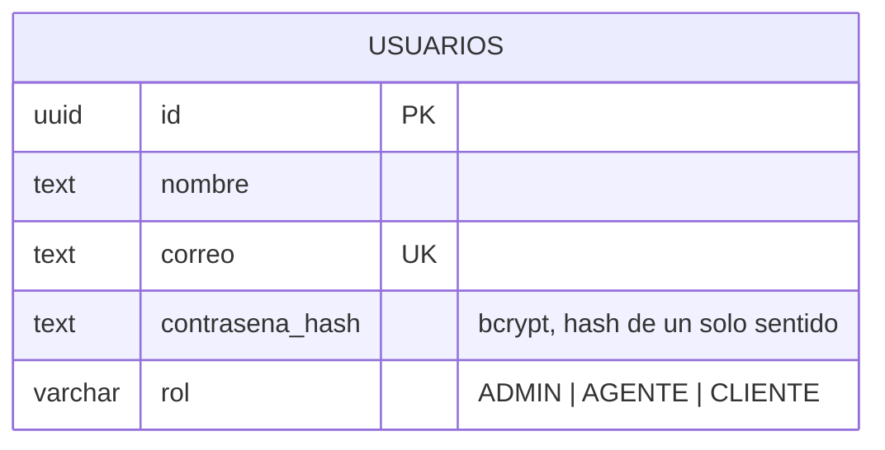

# Identidad (Node/TS, REST)

Registro, login y autorización por roles. Extiende el patrón del `auth-service` de la Práctica 2:
`/authorize` sigue siendo *verify-only* (sin estado más allá de leer el JWT), pero este servicio
también absorbe el registro/login que en P2 vivían en `backend/` — en P4 identidad es un único
microservicio autocontenido, no dos servicios separados como en P2.

Contrato completo (Swagger/OpenAPI): [`../../identidad-service/openapi.yaml`](../../identidad-service/openapi.yaml),
servido interactivamente en `GET /docs` (directo: `http://localhost:4100/docs`; vía Gateway:
`http://localhost:4000/api/identidad/docs`).

## Endpoints

| Método | Ruta | Rol requerido | Descripción |
|---|---|---|---|
| POST | `/registro` | Público | Crea una cuenta nueva (siempre con rol `CLIENTE`) |
| POST | `/login` | Público | Verifica credenciales y devuelve un JWT (`{ usuario, token }`) |
| POST | `/authorize` | Interno (lo llaman otros microservicios) | Verifica un token y devuelve `{ allowed, usuario? }` |
| GET | `/health` | Público | Estado del servicio |

`rol` es uno de `ADMIN`, `AGENTE`, `CLIENTE`. El registro público nunca permite auto-asignarse
`ADMIN` o `AGENTE`: esas cuentas se crean por semilla automática al arrancar el servicio
(`ADMIN_EMAIL`/`AGENTE1_EMAIL`/`AGENTE2_EMAIL` en `.env`, ver `README.md`).

## Diagrama ER

## Notas

- **Contraseña con bcrypt, no AES.** A diferencia de P2 (donde la rúbrica exigía poder
  desencriptar nombre/correo/contraseña), P4 no tiene ese requisito, así que la contraseña se
  guarda como hash de un solo sentido (bcrypt) — la práctica recomendada por la industria, y más
  simple porque ya no hace falta una clave de cifrado simétrica ni un `correo_hash` aparte para
  poder buscar por correo (el correo ya no está cifrado, se busca directo).
- **`/authorize` devuelve al usuario, no solo un booleano.** En P2, el backend decodificaba su
  propio JWT localmente y solo le preguntaba al `auth-service` "¿tiene permiso?". En P4, los
  microservicios que llaman a Identidad (Tickets, Notificaciones) *nunca* conocen `JWT_SECRET`, así
  que necesitan que Identidad les diga también quién hizo la petición (`id`, `correo`, `rol`) para
  poder, por ejemplo, guardar el `clienteId` de un ticket o filtrar "mis tickets".
