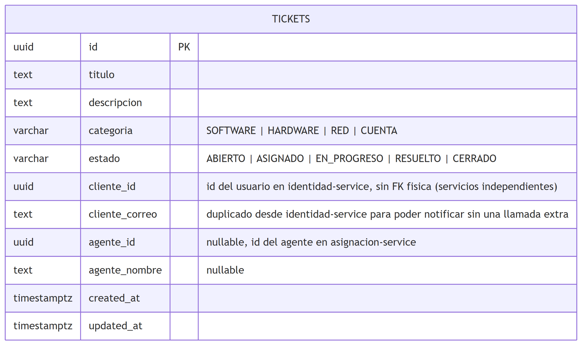

# Tickets (Node/TS, GraphQL)

Creación y ciclo de vida de los tickets de soporte. Es el servicio de negocio central: al crear un
ticket, dispara la asignación de agente y la notificación correspondiente llamando directamente a
los otros dos microservicios (sin pasar por el Gateway ni por un broker de mensajería).

Contrato completo (SDL GraphQL): [`../../tickets-service/schema.graphql`](../../tickets-service/schema.graphql),
explorable interactivamente con Apollo Sandbox en `POST /graphql` (directo:
`http://localhost:4200/graphql`; vía Gateway: `http://localhost:4000/api/tickets`) — el equivalente
GraphQL de Swagger UI para un servicio REST.

## Operaciones

| Tipo | Operación | Rol requerido | Descripción |
|---|---|---|---|
| Query | `tickets` | CLIENTE, AGENTE, ADMIN | CLIENTE ve solo los suyos; AGENTE/ADMIN ven todos |
| Query | `ticket(id)` | CLIENTE, AGENTE, ADMIN | CLIENTE solo puede consultar sus propios tickets |
| Mutation | `crearTicket(titulo, descripcion, categoria)` | CLIENTE | Crea el ticket, asigna agente y notifica |
| Mutation | `actualizarEstadoTicket(id, nuevoEstado)` | AGENTE, ADMIN | Notifica al cliente si `nuevoEstado = RESUELTO` |

Toda operación requiere el header `Authorization: Bearer <token>` (obtenido de `POST /login` en
Identidad); el rol se valida consultando `POST /authorize` en Identidad, nunca decodificando el
JWT localmente.

## Diagrama ER

Fuente editable (Mermaid): [`../diagramas/src/04-er-tickets.mmd`](../diagramas/src/04-er-tickets.mmd).

## Notas

- **`cliente_id` y `agente_id` no son llaves foráneas físicas.** Apuntan a filas en las bases de
  datos de Identidad y de Asignación respectivamente, que son bases de datos *distintas*
  (database-per-service): no se puede tener una FK real entre bases de datos separadas. Es el mismo
  trade-off de "duplicación controlada" documentado en el diseño de P3.
- **Flujo de creación (`crearTicket`)**: valida rol `CLIENTE` vía Identidad → guarda el ticket en
  estado `ABIERTO` → llama a `POST /asignaciones` en Asignación de Agentes (si hay agente
  disponible para la categoría, el ticket pasa a `ASIGNADO`) → llama a la mutation
  `registrarNotificacion` en Notificaciones. Un fallo en los dos últimos pasos **no revierte la
  creación del ticket** (consistencia eventual): solo se registra en el log del servicio.
