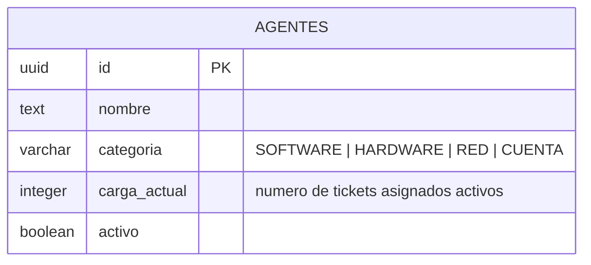

# Asignación de Agentes (Python/FastAPI, REST)

Elige el agente activo con menor carga actual para la categoría de un ticket. Es el único
microservicio en Python — deliberadamente el de menor criticidad/alcance (sin JWT, sin GraphQL),
para acotar el riesgo de introducir un segundo lenguaje nuevo en el proyecto.

Contrato completo (Swagger/OpenAPI, generado automáticamente por FastAPI a partir del propio
código): `GET /docs` y `GET /openapi.json` (directo: `http://localhost:8000/docs`; vía Gateway:
`http://localhost:4000/api/asignacion/docs`) — no se escribió un `openapi.yaml` a mano porque
FastAPI ya lo deriva del código sin trabajo adicional ni riesgo de desincronizarse.

## Endpoints

| Método | Ruta | Autenticación | Descripción |
|---|---|---|---|
| POST | `/asignaciones` | `X-Internal-Secret` (servicio-a-servicio) | Asigna el agente activo con menor carga de la categoría pedida; incrementa su carga |
| GET | `/agentes` | Público | Lista todos los agentes y su carga actual |
| GET | `/health` | Público | Estado del servicio |

`POST /asignaciones` no la llama un usuario final sino `tickets-service` directamente
(comunicación directa entre microservicios, recomendada por el enunciado de P4). En vez de
duplicar la verificación de JWT/roles de Identidad en un tercer lenguaje, se protege con un
secreto compartido simple — ver justificación completa en `README.md`.

## Diagrama ER

## Notas

- **Asignación por menor carga (round-robin ponderado), no aleatoria.** Entre los agentes activos
  de la categoría pedida, se elige el de menor `carga_actual` y se le incrementa en 1 — una
  aproximación simple pero determinista a balancear la carga de trabajo entre agentes.
- **Categorías sin agente disponible no son un error.** Si no hay ningún agente activo para la
  categoría del ticket, `POST /asignaciones` responde `{ "agente": null }` (200 OK): el ticket en
  Tickets simplemente queda `ABIERTO` sin agente, a la espera de asignación manual.
- Se sembraron por defecto dos agentes (`SOFTWARE` y `HARDWARE`) al arrancar el servicio, para que
  el flujo de creación de tickets sea demostrable sin pasos manuales.
