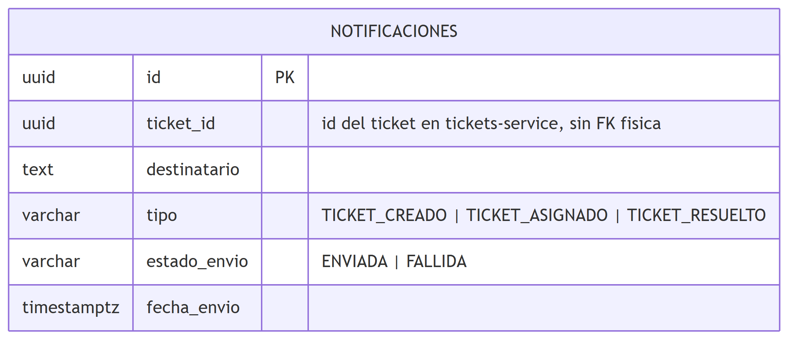

# Notificaciones (Node/TS, GraphQL)

Registra el envío (simulado) de una notificación por correo cuando un ticket se crea, se asigna o
se resuelve, y expone el historial de envíos por ticket.

Contrato completo (SDL GraphQL): [`../../notificaciones-service/schema.graphql`](../../notificaciones-service/schema.graphql),
explorable con Apollo Sandbox en `POST /graphql` (directo: `http://localhost:4400/graphql`; vía
Gateway: `http://localhost:4000/api/notificaciones`).

## Operaciones

| Tipo | Operación | Autenticación | Descripción |
|---|---|---|---|
| Mutation | `registrarNotificacion(ticketId, destinatario, tipo)` | `X-Internal-Secret` (servicio-a-servicio) | Simula el envío y deja registro (`ENVIADA`/`FALLIDA`) |
| Query | `historialNotificaciones(ticketId)` | `Authorization: Bearer <token>`, rol AGENTE o ADMIN | Historial de notificaciones de un ticket |

`registrarNotificacion` es de uso interno (la invoca `tickets-service`, nunca un usuario final),
protegida igual que `POST /asignaciones` en Asignación de Agentes. `historialNotificaciones` sí es
una consulta de usuario final, y se autoriza contra Identidad como cualquier otra operación de
Tickets.

## Diagrama ER

Fuente editable (Mermaid): [`../diagramas/src/06-er-notificaciones.mmd`](../diagramas/src/06-er-notificaciones.mmd).

## Notas

- **El envío de correo es simulado**, no SMTP real: se registra en el log del contenedor
  (`[notificaciones-service] correo simulado -> ... `) y siempre se marca `ENVIADA`. La interfaz
  `IEmailSender` es el puerto (DIP) que aislaría un proveedor real (SMTP/SES, como en el diseño de
  P3) sin tocar el caso de uso — cambiar de simulado a real es reemplazar una sola clase de
  infraestructura.
- **`ticket_id` no es una llave foránea física** por la misma razón que en Tickets/Asignación:
  cada microservicio tiene su propia base de datos (database-per-service).
