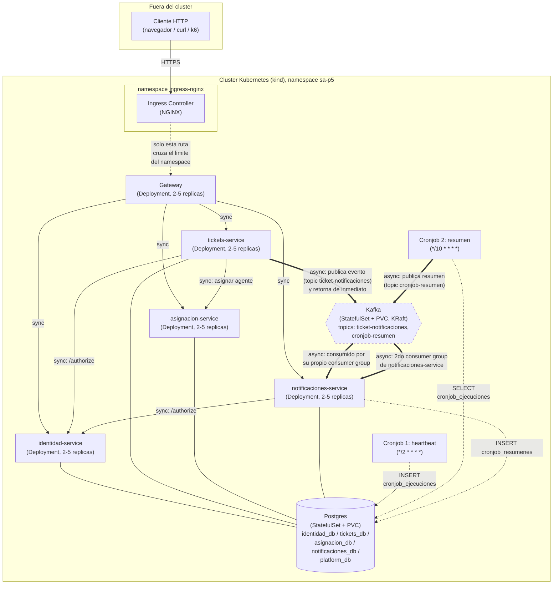

# Diagrama de arquitectura

## Elementos dentro/fuera del clúster, flujos síncronos/asíncronos y límites de NetworkPolicy

**Leyenda:**
- Línea sólida (`-->`) = llamada síncrona (HTTP/GraphQL o SQL), quien llama
  espera la respuesta.
- Línea gruesa (`==>`) = flujo asíncrono vía Kafka: quien publica **no**
  espera a que el mensaje sea procesado.
- Línea punteada fina (`-.->`) = escritura/lectura puntual de un cronjob o
  del segundo consumidor contra Postgres.

## Límites impuestos por las NetworkPolicies

Namespace `sa-p5`, sin ninguna policy activa el tráfico sería libre entre
cualquier par de pods (comportamiento por defecto de Kubernetes). Con las 7
`NetworkPolicy` propias (`charts/sa-platform/templates/networkpolicies.yaml`),
el grafo de tráfico permitido queda reducido exactamente a las flechas del
diagrama de arriba:

| Destino | Origen permitido (ingreso) | Puerto |
|---|---|---|
| `gateway` | pods del namespace `ingress-nginx` (Ingress Controller) | 4000 |
| `identidad-service` | `gateway`, `tickets-service`, `notificaciones-service` | 4100 |
| `tickets-service` | `gateway` | 4200 |
| `asignacion-service` | `gateway`, `tickets-service` | 8000 |
| `notificaciones-service` | `gateway` | 4400 |
| `postgres` | `identidad-service`, `tickets-service`, `asignacion-service`, `notificaciones-service`, `cronjob-heartbeat`, `cronjob-resumen` | 5432 |
| `kafka` | `tickets-service`, `notificaciones-service`, `cronjob-resumen`, `kafka-topics-init` (Job de setup) | 9092 |

Cualquier otro origen (por ejemplo, un pod de prueba sin esas labels, o un
intento de `asignacion-service` -> `identidad-service` que el diseño no usa)
queda bloqueado -- demostrado con evidencia real en
`docs/evidencia/02-networkpolicy.md`. Los microservicios y el broker/BD
**nunca** se exponen con `NodePort` ni `LoadBalancer`; el único objeto con
salida hacia afuera del cluster es el `Ingress` de `gateway`.
