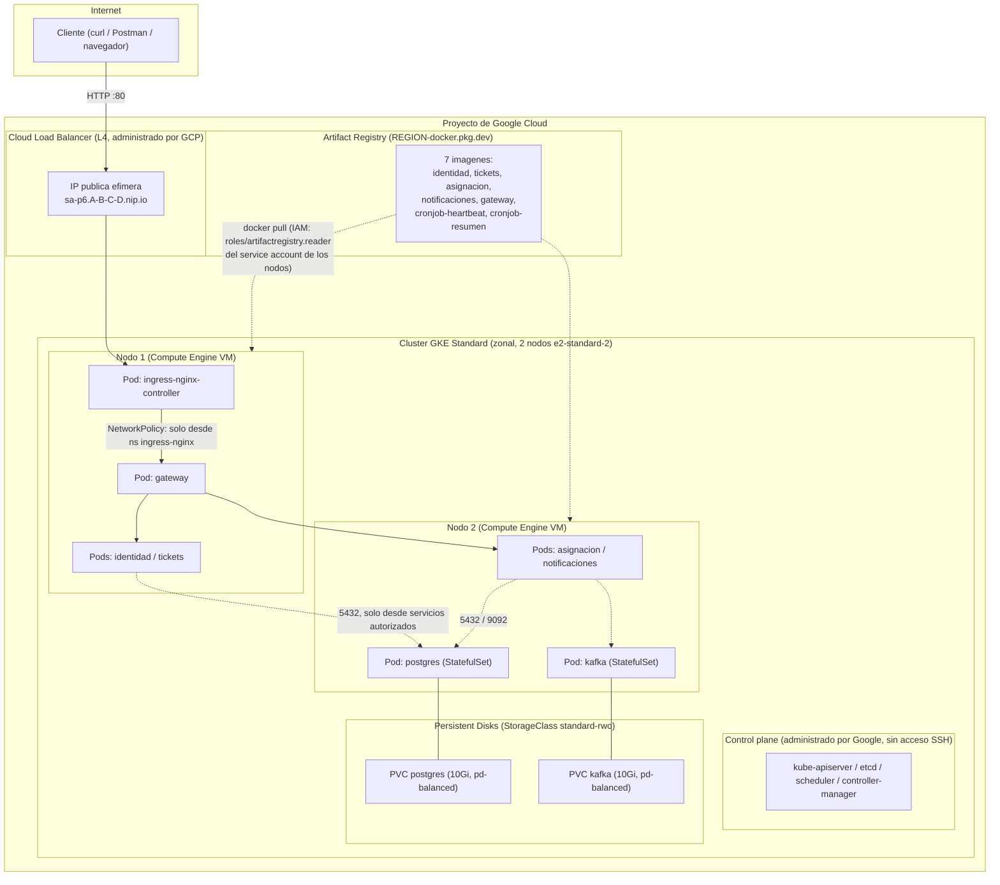

# Arquitectura en la nube (GKE)

La topología lógica de la aplicación (servicios, Postgres, Kafka,
NetworkPolicies) es la misma de
`../../../P5/docs/diagramas/01-arquitectura.md`. Lo que cambia en esta
práctica es **quién provee cada pieza de infraestructura alrededor de esa
topología** — ver la tabla de `../../README.md`. Este diagrama muestra esa
capa de infraestructura.

## Qué administra Google y qué sigue siendo responsabilidad del estudiante

Ver la respuesta completa en `../preguntas-teoricas.md` (pregunta 4); resumen
visual:

| Administrado por GCP (GKE) | Responsabilidad del estudiante |
|---|---|
| Control plane (`kube-apiserver`, `etcd`, scheduler) | El chart de Helm y sus `values-*.yaml` |
| Parcheo del SO de los nodos y de Kubernetes (`release-channel: regular`) | Las imágenes de las 7 aplicaciones (Dockerfile, build, push) |
| El Load Balancer L4 físico y su IP pública | El `Ingress`/`Service` que lo solicita, y las `NetworkPolicy` |
| Aprovisionamiento del Persistent Disk al crear el PVC | El tamaño/StorageClass pedido en el PVC, y los backups de los datos |
| Alta disponibilidad del control plane | La disponibilidad de las réplicas de cada Deployment (HPA, PDB) |
| — | Los `Secrets` (contraseñas, JWT) y no filtrarlos al repositorio |
| — | Los costos que generan los recursos que el estudiante crea |
