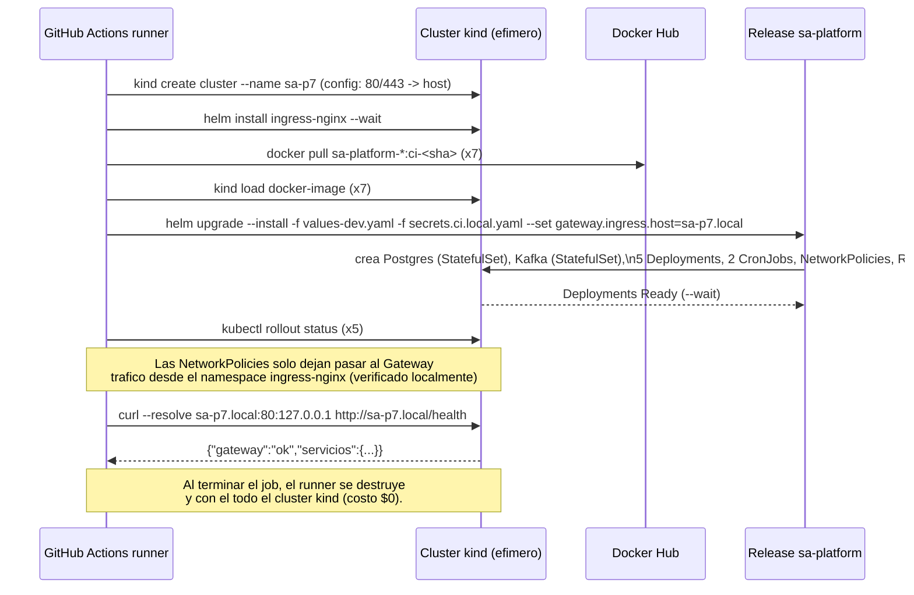

# Diagrama del pipeline CI/CD

## Vista general (4 etapas + generación de versión)

```mermaid
flowchart LR
    subgraph Trigger["Disparadores"]
        PR["Pull Request → master"]
        PUSH["Push → master"]
        TAG["Tag p7-v*.*.*"]
        MANUAL["workflow_dispatch"]
    end

    subgraph E1["1. Build"]
        B1["tsc build\n(identidad, tickets,\nnotificaciones, gateway)"]
        B2["python -m compileall\n(asignacion-service)"]
    end

    subgraph E2["2. Test"]
        T1["node --test\n(casos de uso c/fakes)"]
        T2["pytest\n(casos de uso c/fakes)"]
    end

    subgraph E3["3. Dockerización + Push"]
        D1["docker buildx build\n(7 imagenes)"]
        D2["push → Docker Hub\n(4 tags: sha, branch,\nlatest, semver)"]
    end

    subgraph E4["4. Deploy a Kubernetes"]
        K0["kind create cluster\n(efimero, en el runner,\ncon port-mapping 80/443)"]
        K1["helm install ingress-nginx\n--wait"]
        K2["docker pull + kind load\n(las 7 imagenes)"]
        K3["helm upgrade --install\nsa-platform (Postgres+Kafka\n+ 5 servicios + 2 cronjobs)"]
        K4["kubectl rollout status"]
        K5["smoke test: curl --resolve\na traves del Ingress"]
    end

    PR --> E1
    PUSH --> E1
    TAG --> E1
    MANUAL --> E1

    B1 --> T1
    B2 --> T2

    T1 -->|"solo si NO es PR"| D1
    T2 -->|"solo si NO es PR"| D1
    D1 --> D2

    D2 --> K0 --> K1 --> K2 --> K3 --> K4 --> K5

    subgraph E5["5. Generacion de version (solo tags p7-v*.*.*)"]
        R1["gh release create\ncon el numero de version"]
        R2["Registro: GitHub Releases\n+ notas + imagenes Docker Hub\nde esa version"]
    end

    K5 -->|"solo si el ref es un tag p7-v*"| R1 --> R2

    style PR fill:#f8f2e6,stroke:#b08a3c
    style E4 fill:#eef5ee,stroke:#3c7a45
    style E5 fill:#f3eef8,stroke:#7a3c9e
```

## Detalle del job `deploy` (etapa 4)

## Cómo leer el grafo real en GitHub

En la pestaña **Actions → (una corrida) → p7-ci-cd.yml**, GitHub dibuja un
grafo equivalente con nodos reales por cada combinación de matrix (5 nodos
`build-test`, 7 nodos `docker`, 1 nodo `deploy`, y — solo en una corrida
disparada por un tag `p7-v*.*.*` — 1 nodo `release`), conectados por las
dependencias `needs:`. Esa vista **es** la evidencia visual que pide la
rúbrica (punto 1.2, Diagrama pipeline) además de este diagrama estático —
ver `docs/evidencia/README.md` para dónde queda la captura.
