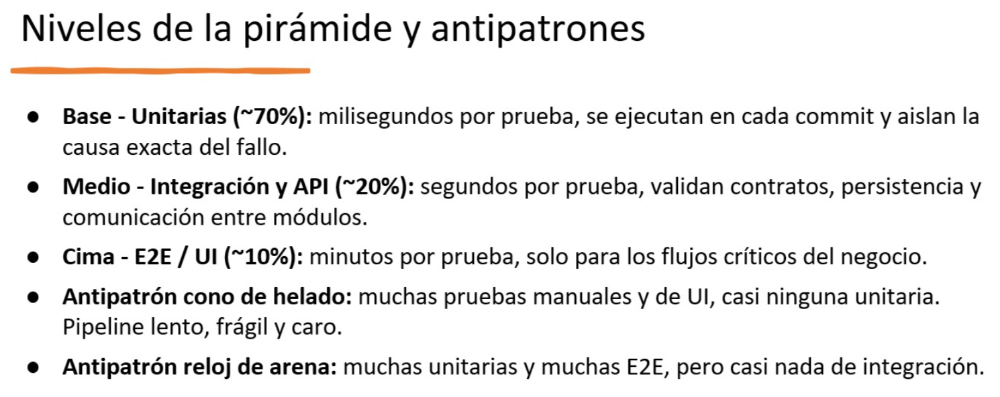

# Estrategia de pruebas

Referencia usada para decidir qué pruebas agregar en la etapa "Test" del
pipeline (`.github/workflows/p7-ci-cd.yml`, job `build-test`): la pirámide
clásica — base ancha de unitarias, capa media de integración, punta angosta
de E2E — y sus dos antipatrones (cono de helado, reloj de arena).

## Qué se implementó, por nivel

| Nivel | % objetivo | Qué se agregó | Dónde |
|---|---|---|---|
| **Unitarias** | ~70% | Casos de uso probados con **fakes en memoria** de sus puertos (repositorios, hashers, clientes HTTP, publicadores de eventos) — milisegundos por prueba, aíslan la causa exacta del fallo. | `*/src/__tests__/*.test.ts` (Node), `asignacion-service/tests/test_use_cases.py` |
| **Integración** | ~20% | Los **repositorios reales** (`PostgresUsuarioRepository`, `PostgresTicketRepository`, `PostgresNotificacionRepository`, `SqlAlchemyAgenteRepository`) probados contra un **Postgres real** (contenedor `services:` del job, no un mock) — aplican la migración `.sql` versionada de cada servicio y validan que el contrato SQL (columnas, tipos, `UNIQUE`, `CHECK`) sigue siendo compatible con el código. | `*/src/__tests__/*.integration.test.ts`, `asignacion-service/tests/test_agente_repository_integration.py` |
| **E2E** | ~10% (pirámide) → **0% en este pipeline** | **Decisión explícita: no se implementan.** Ver justificación abajo. | — |

11 archivos de prueba, 27 casos en total (16 unitarias + 11 de integración)
corriendo en cada push/PR contra los 5 servicios.

## Por qué no hay nivel E2E

Una prueba E2E real recorrería el flujo de negocio completo (registro →
login → crear ticket → notificación async vía Kafka) contra el sistema
desplegado de verdad, tal como lo hace la colección de Postman heredada de
P5 (`P6/postman/`, corrible con `newman`). Se decidió **no** integrar esa
suite al pipeline por dos razones concretas:

1. **Es la capa más cara y frágil de la pirámide** (minutos por prueba,
   depende de que Kafka + Postgres + los 5 servicios estén simultáneamente
   sanos) — exactamente lo que la pirámide recomienda minimizar. El
   "antipatrón cono de helado" (muchas pruebas de punta, casi ninguna
   unitaria) es lo opuesto a lo que se buscó: aquí la base (unitarias) es
   deliberadamente la más grande.
2. **El job `deploy` ya hace una verificación de salud equivalente en
   espíritu** (`curl` a `/health` a través del Ingress, ver
   `docs/diagrama-pipeline.md`) — confirma que el sistema desplegado
   responde, pero es un *smoke test* de infraestructura, no una suite E2E de
   casos de negocio con asserts. Añadir Kafka como `services:` del job de
   test (para correr Postman/newman ahí) hubiera más que duplicado el tiempo
   del pipeline por un nivel que la propia pirámide marca como el de menor
   proporción recomendada.

Si en el futuro se quisiera cerrar ese 10%, el camino natural es un job
adicional (`e2e`, después de `deploy`) que corra
`npx newman run P6/postman/sa-platform.postman_collection.json` contra el
`sa-p7.local` del clúster `kind` ya desplegado — la infraestructura para
hacerlo ya existe en este mismo pipeline, solo no se activó.

## Antipatrones evitados (de la imagen)

- **Cono de helado**: evitado — la etapa de test no tiene ninguna prueba
  manual ni de UI, y las unitarias (16) superan ampliamente a las de
  integración (11).
- **Reloj de arena** (muchas unitarias + muchas E2E, casi nada de
  integración): evitado — el nivel de integración existe deliberadamente
  (4 archivos, uno por servicio con persistencia) en vez de saltar
  directo de fakes en memoria a un despliegue completo.
