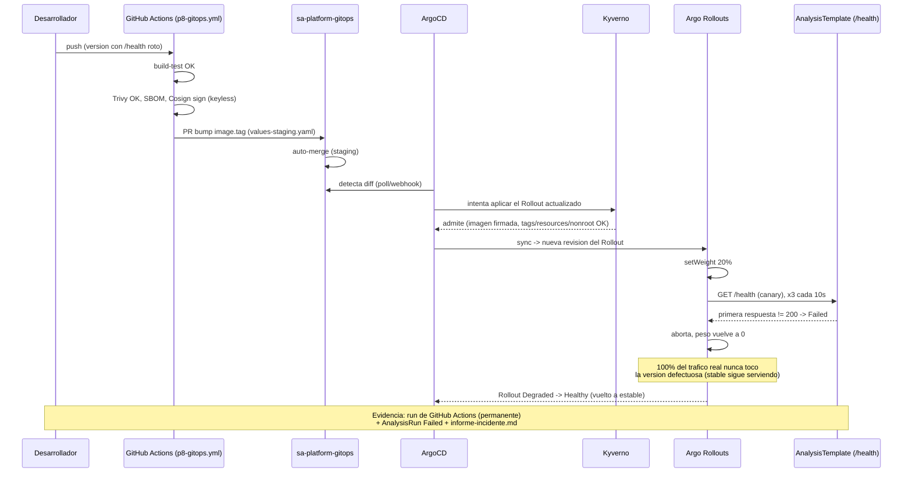

# Diagrama del flujo GitOps (Práctica 8)

Mismo criterio que `P7/docs/diagrama-pipeline.md`: una vista general del
flujo completo (commit → clúster) y una vista de secuencia para el
escenario de fallo inducido + reversión automática. Existe también como
`.drawio` (`01-flujo-gitops.drawio`), con el mismo contenido — ver
`P8/MANUAL_TECNICO.md` para cómo se validó que ambos formatos coinciden.

## Vista general: del commit al clúster

```mermaid
flowchart LR
    DEV["Commit / PR\n(P6 o P8)"]

    subgraph CI["Repo de código - .github/workflows/p8-gitops.yml"]
        BT["build-test\n(unitarias + integracion,\ngate de calidad)"]
        DS["docker-scan-sign\n(x7 imagenes)\nTrivy CRITICAL bloquea"]
        SBOM["SBOM (CycloneDX)\n+ Cosign sign (keyless/OIDC)"]
        PR["gitops-pr\nPR -> values-staging.yaml\n(solo bump de image.tag)"]
    end

    subgraph GITOPS["Repo GitOps - sa-platform-gitops (independiente)"]
        VS["values-staging.yaml\n(auto-merge)"]
        VP["values-prod.yaml\n(merge manual = gate de promocion)"]
        SS["sealed-secrets/*.yaml\n(ciphertext, nunca texto plano)"]
    end

    subgraph CLUSTER["Cluster kind - sa-p8"]
        ARGO["ArgoCD\n(unico componente que aplica\ncambios al cluster, selfHeal)"]
        KYVERNO{{"Kyverno\n(admision: latest, resources,\nnonroot, firma Cosign)"}}
        SEALED["Sealed Secrets controller\n(descifra SealedSecret -> Secret)"]
        ROLLOUT["Argo Rollouts\ncanary 20% -> analysis -> 50% -> analysis -> 100%"]
        ANALYSIS{{"AnalysisTemplate\nprovider: web GET /health"}}
        STABLE["Version estable\n(100% trafico hasta que\nel canary se promueve)"]
    end

    DEV --> BT --> DS --> SBOM --> PR
    PR --> VS
    PR -.PR manual.-> VP
    VS --> ARGO
    VP --> ARGO
    SS --> SEALED
    ARGO -->|sync| KYVERNO
    KYVERNO -->|admite| ROLLOUT
    KYVERNO -->|rechaza| REJECT["Despliegue rechazado\n(evidencia: P8/docs/evidencia)"]
    SEALED -->|Secret materializado| ROLLOUT
    ROLLOUT --> ANALYSIS
    ANALYSIS -->|exito x3| PROMOTE["Promueve al siguiente paso\n(hasta 100%)"]
    ANALYSIS -->|1 fallo| ABORT["Aborta: peso -> 0\n(reversion automatica)"]
    PROMOTE --> STABLE
    ABORT --> STABLE

    style DS fill:#f8f2e6,stroke:#b08a3c
    style KYVERNO fill:#f3eef8,stroke:#7a3c9e
    style ANALYSIS fill:#eef5ee,stroke:#3c7a45
    style ABORT fill:#fbeaea,stroke:#a33c3c
    style REJECT fill:#fbeaea,stroke:#a33c3c
```

## Vista de secuencia: fallo inducido y reversión automática

