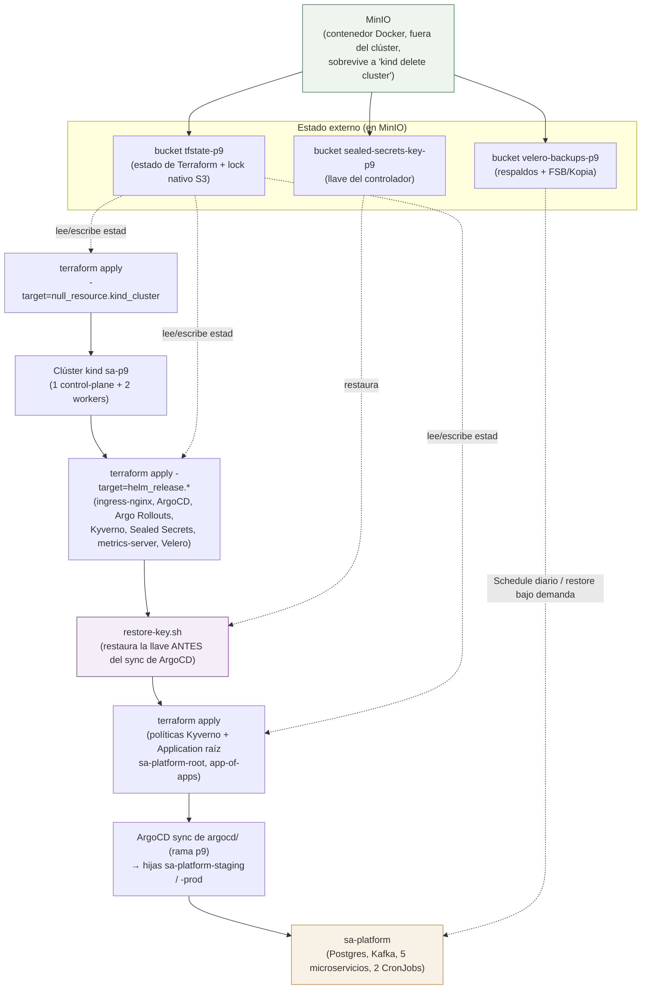
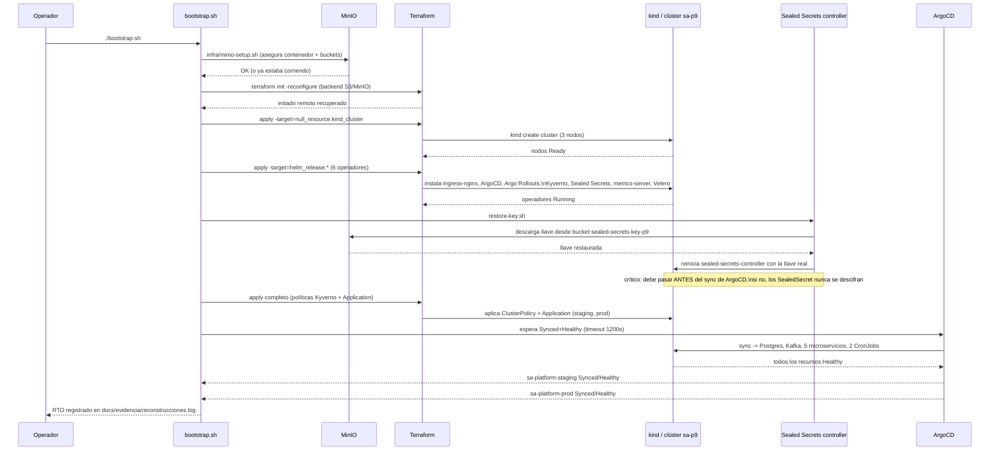

# Diagrama del bootstrap (Práctica 9)

Mismo criterio que `P8/docs/diagramas/01-flujo-gitops.md`: una vista
general del orden de reconstrucción y sus dependencias, y una vista de
secuencia del camino real que sigue `bootstrap.sh`. Solo en formato
Mermaid (`.md`) — a diferencia de P8, no se generó una versión `.drawio`
equivalente para esta práctica.

## Vista general: dependencias entre componentes

El punto central del diagrama es que **MinIO es la única pieza que no se
reconstruye** — todo lo demás (clúster, operadores, llave de Sealed
Secrets, políticas, aplicación) se deriva de lo que vive ahí. Si MinIO
se pierde, no hay bootstrap posible sin intervención manual (ver
`docs/runbook-recuperacion.md`, sección 6).

## Vista de secuencia: `bootstrap.sh` paso a paso

Evidencia real de una corrida completa de este flujo, con marcas de
tiempo por paso: `docs/evidencia/fase7-reconstruccion.md`.
